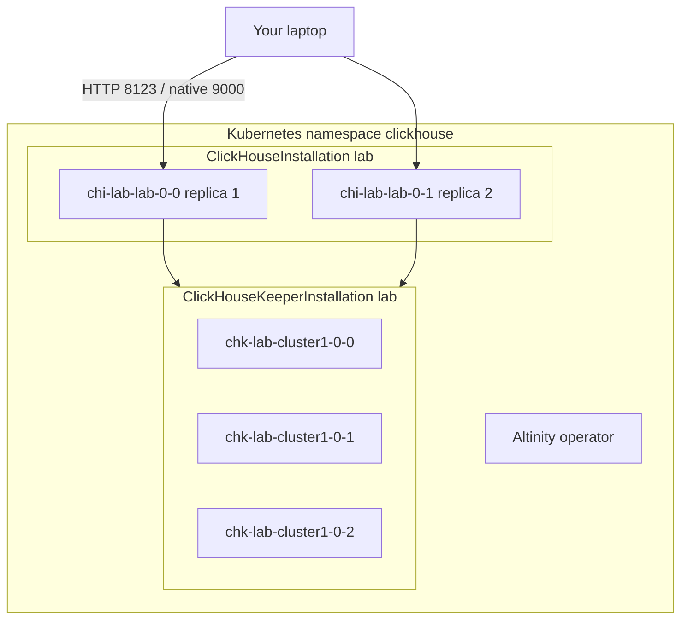

# Cluster layout, tables, connection, and example queries

This page describes the **lab ClickHouse cluster** as deployed by Ansible (`kind` cluster `clickhouse-lab`, namespace `clickhouse`). Credentials below are for this laptop lab only.

## Cluster structure



| Layer | Name | What it is |
| --- | --- | --- |
| kind cluster | `clickhouse-lab` | 1 control-plane + 2 workers |
| CHI (ClickHouseInstallation) | `lab` | Operator-managed ClickHouse |
| ClickHouse cluster name | `lab` | Used in `ON CLUSTER 'lab'` and `Distributed('lab', …)` |
| Layout | 1 shard × 2 replicas | Both replicas store the same `nyc.trips` parts |
| Pods | `chi-lab-lab-0-0-0`, `chi-lab-lab-0-1-0` | ClickHouse 25.8 |
| CHK (Keeper) | `lab`, 3 replicas | Coordination on port 2181 (`keeper-lab`) |
| Cluster secret | auto-generated by the operator | Lets Distributed queries authenticate between replicas |

`system.clusters` for `cluster = 'lab'`:

| shard_num | replica_num | host_name |
| ---: | ---: | --- |
| 1 | 1 | `chi-lab-lab-0-0` |
| 1 | 2 | `chi-lab-lab-0-1` |

Inspect live:

```sql
SELECT cluster, shard_num, replica_num, host_name
FROM system.clusters
WHERE cluster = 'lab';
```

```bash
export KUBECONFIG="$PWD/.kube/config"
kubectl get chi,chk,pods -n clickhouse
```

## Table structure

Database: **`nyc`**. Data comes from ClickHouse’s public NYC taxi file `trips_0.gz` (~1,000,660 rows after load).

### `nyc.trips` (local, replicated)

Engine: `ReplicatedMergeTree('/clickhouse/tables/{uuid}/{shard}', '{replica}')`  
Partition: `toYYYYMM(pickup_date)`  
Order: `(pickup_datetime, trip_id)`  
Replication: 2/2 active replicas.

| Column | Type | Meaning |
| --- | --- | --- |
| `trip_id` | UInt32 | Trip identifier |
| `vendor_id` | String | Vendor |
| `pickup_date` | Date | Pickup calendar date |
| `pickup_datetime` | DateTime | Pickup timestamp |
| `dropoff_date` | Date | Dropoff calendar date |
| `dropoff_datetime` | DateTime | Dropoff timestamp |
| `store_and_fwd_flag` | UInt8 | Store-and-forward flag |
| `rate_code_id` | UInt8 | Rate code |
| `pickup_longitude` | Float64 | Pickup longitude |
| `pickup_latitude` | Float64 | Pickup latitude |
| `dropoff_longitude` | Float64 | Dropoff longitude |
| `dropoff_latitude` | Float64 | Dropoff latitude |
| `passenger_count` | UInt8 | Passengers |
| `trip_distance` | Float64 | Distance |
| `fare_amount` | Float32 | Fare |
| `extra` | Float32 | Extra charges |
| `mta_tax` | Float32 | MTA tax |
| `tip_amount` | Float32 | Tip |
| `tolls_amount` | Float32 | Tolls |
| `ehail_fee` | Float32 | E-hail fee |
| `improvement_surcharge` | Float32 | Improvement surcharge |
| `total_amount` | Float32 | Total charged |
| `payment_type` | String | Payment type |
| `trip_type` | UInt8 | Trip type |
| `pickup` | String | Pickup location blob |
| `dropoff` | String | Dropoff location blob |
| `cab_type` | String | yellow / green / etc. |
| `pickup_nyct2010_gid` | Int8 | Pickup census tract gid |
| `pickup_ctlabel` | Float32 | Pickup census tract label |
| `pickup_borocode` | Int8 | Pickup borough code |
| `pickup_ct2010` | String | Pickup census tract 2010 |
| `pickup_boroct2010` | String | Pickup boro+tract |
| `pickup_cdeligibil` | String | Pickup CD eligibility |
| `pickup_ntacode` | String | Pickup NTA code |
| `pickup_ntaname` | String | Pickup neighborhood (NTA) |
| `pickup_puma` | UInt16 | Pickup PUMA |
| `dropoff_nyct2010_gid` | UInt8 | Dropoff census tract gid |
| `dropoff_ctlabel` | Float32 | Dropoff census tract label |
| `dropoff_borocode` | UInt8 | Dropoff borough code |
| `dropoff_ct2010` | String | Dropoff census tract 2010 |
| `dropoff_boroct2010` | String | Dropoff boro+tract |
| `dropoff_cdeligibil` | String | Dropoff CD eligibility |
| `dropoff_ntacode` | String | Dropoff NTA code |
| `dropoff_ntaname` | String | Dropoff neighborhood (NTA) |
| `dropoff_puma` | UInt16 | Dropoff PUMA |

DDL (same as on the running cluster):

```sql
CREATE TABLE nyc.trips
(
    trip_id UInt32,
    vendor_id String,
    pickup_date Date,
    pickup_datetime DateTime,
    dropoff_date Date,
    dropoff_datetime DateTime,
    store_and_fwd_flag UInt8,
    rate_code_id UInt8,
    pickup_longitude Float64,
    pickup_latitude Float64,
    dropoff_longitude Float64,
    dropoff_latitude Float64,
    passenger_count UInt8,
    trip_distance Float64,
    fare_amount Float32,
    extra Float32,
    mta_tax Float32,
    tip_amount Float32,
    tolls_amount Float32,
    ehail_fee Float32,
    improvement_surcharge Float32,
    total_amount Float32,
    payment_type String,
    trip_type UInt8,
    pickup String,
    dropoff String,
    cab_type String,
    pickup_nyct2010_gid Int8,
    pickup_ctlabel Float32,
    pickup_borocode Int8,
    pickup_ct2010 String,
    pickup_boroct2010 String,
    pickup_cdeligibil String,
    pickup_ntacode String,
    pickup_ntaname String,
    pickup_puma UInt16,
    dropoff_nyct2010_gid UInt8,
    dropoff_ctlabel Float32,
    dropoff_borocode UInt8,
    dropoff_ct2010 String,
    dropoff_boroct2010 String,
    dropoff_cdeligibil String,
    dropoff_ntacode String,
    dropoff_ntaname String,
    dropoff_puma UInt16
)
ENGINE = ReplicatedMergeTree('/clickhouse/tables/{uuid}/{shard}', '{replica}')
PARTITION BY toYYYYMM(pickup_date)
ORDER BY (pickup_datetime, trip_id);
```

### `nyc.trips_dist` (distributed)

Same columns as `nyc.trips`. Engine: `Distributed('lab', 'nyc', 'trips', cityHash64(trip_id))`.

Use this table when you want the query planner to fan out across replicas. For this lab there is a single shard, so `trips` and `trips_dist` return the same row counts; `trips_dist` is still the right pattern for apps that should not pin a replica.

```sql
CREATE TABLE nyc.trips_dist
AS nyc.trips
ENGINE = Distributed('lab', 'nyc', 'trips', cityHash64(trip_id));
```

Print live DDL:

```sql
SHOW CREATE TABLE nyc.trips;
SHOW CREATE TABLE nyc.trips_dist;
```

## How to connect

| From | Endpoint | Auth |
| --- | --- | --- |
| Laptop HTTP | `http://127.0.0.1:8123` | user `default`, password `clickhouse` |
| Laptop native TCP | `127.0.0.1:9000` | same |
| In-cluster HTTP | `clickhouse-lab.clickhouse.svc:8123` or `clickhouse-http.clickhouse.svc:8123` | same |
| In-cluster native | `clickhouse-lab.clickhouse.svc:9000` or `clickhouse-native.clickhouse.svc:9000` | same |
| Metrics | `:9363/metrics` (NodePort service `clickhouse-http` maps host via kind; in-cluster scrape uses the Service) | Prometheus |

kind maps host **8123 → NodePort 30081** (HTTP) and host **9000 → NodePort 30090** (native).

### HTTP (`curl`)

```bash
curl 'http://127.0.0.1:8123/?user=default&password=clickhouse' \
  --data-binary 'SELECT version(), fqdn()'
```

### Native client from a pod

```bash
export KUBECONFIG="$PWD/.kube/config"
kubectl -n clickhouse exec -it chi-lab-lab-0-0-0 -- \
  clickhouse-client --password=clickhouse
```

### Native client from the laptop (if `clickhouse-client` is installed)

```bash
clickhouse-client --host 127.0.0.1 --port 9000 \
  --user default --password clickhouse
```

### Python (HTTP)

```python
import urllib.request

url = "http://127.0.0.1:8123/?user=default&password=clickhouse"
sql = "SELECT count() FROM nyc.trips_dist"
print(urllib.request.urlopen(url, data=sql.encode()).read().decode())
```

## Example queries

Prefer `nyc.trips_dist` for application-style reads. `nyc.trips` is the local replica table.

```sql
-- Row count (expect ~1000660 after load-data)
SELECT count() FROM nyc.trips_dist;

-- Schema peek
DESCRIBE TABLE nyc.trips;

-- Average fare by year
SELECT
    toYear(pickup_date) AS year,
    round(avg(fare_amount), 2) AS avg_fare,
    count() AS trips
FROM nyc.trips_dist
GROUP BY year
ORDER BY year;

-- Busiest pickup neighborhoods
SELECT
    pickup_ntaname,
    count() AS trips
FROM nyc.trips_dist
WHERE pickup_ntaname != ''
GROUP BY pickup_ntaname
ORDER BY trips DESC
LIMIT 10;

-- Tip rate by payment type
SELECT
    payment_type,
    count() AS trips,
    round(avg(tip_amount), 2) AS avg_tip,
    round(avg(total_amount), 2) AS avg_total
FROM nyc.trips_dist
GROUP BY payment_type
ORDER BY trips DESC;

-- Replication health
SELECT
    database,
    table,
    is_leader,
    total_replicas,
    active_replicas
FROM system.replicas
WHERE table = 'trips';

-- Cluster topology
SELECT cluster, shard_num, replica_num, host_name
FROM system.clusters
WHERE cluster = 'lab';
```

Same queries via HTTP:

```bash
curl 'http://127.0.0.1:8123/?user=default&password=clickhouse' \
  --data-binary 'SELECT count() FROM nyc.trips_dist'

curl 'http://127.0.0.1:8123/?user=default&password=clickhouse' \
  --data-binary "SELECT pickup_ntaname, count() AS trips FROM nyc.trips_dist WHERE pickup_ntaname != '' GROUP BY pickup_ntaname ORDER BY trips DESC LIMIT 10 FORMAT PrettyCompact"
```

Load more data or reload: `./scripts/lab.sh load-data`. Health check: `./scripts/lab.sh verify`.
