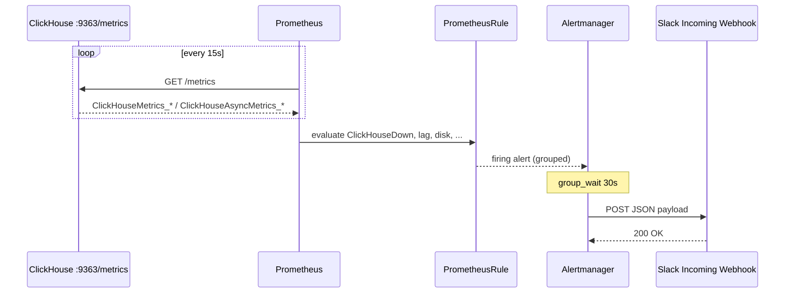

# Standalone Mermaid sources

These files are copies of the diagrams in [how-it-works.md](../how-it-works.md) for blog tooling (Notion, GitHub, mermaid.live, Hugo).

Rendered copies (regenerate with `npx --yes @mermaid-js/mermaid-cli`):

| File | Diagram |
| --- | --- |
| `architecture.mmd` / `architecture.svg` | Laptop → kind → ClickHouse / monitoring / Slack |
| `alerting.mmd` / `alerting.svg` | Prometheus scrape → Alertmanager → Slack webhook |
