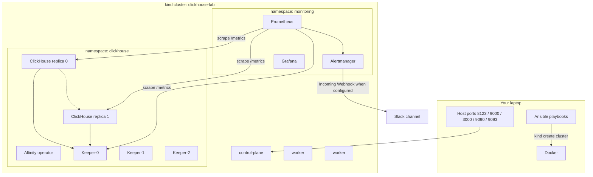
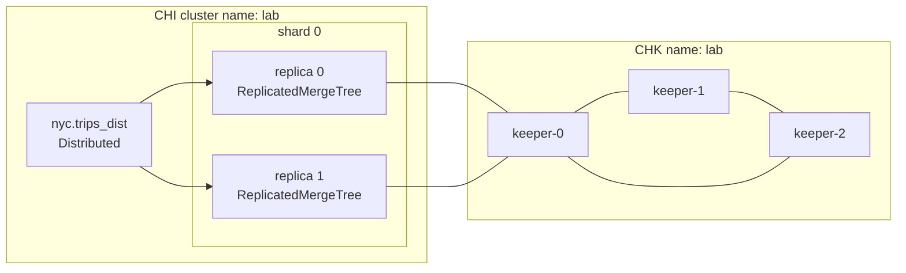
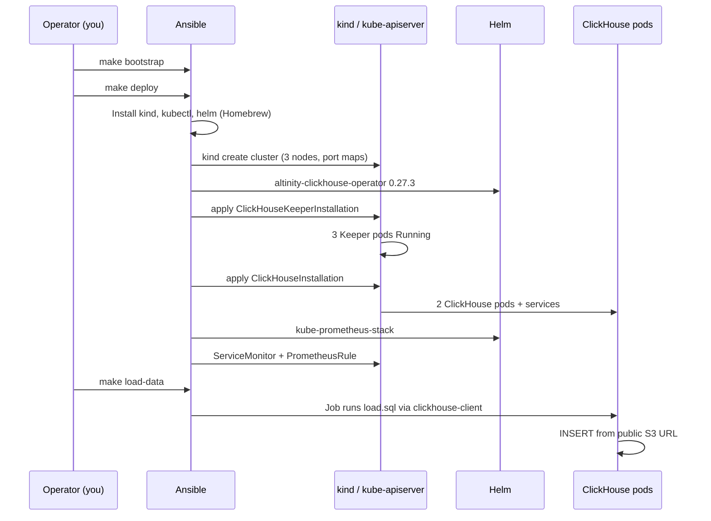
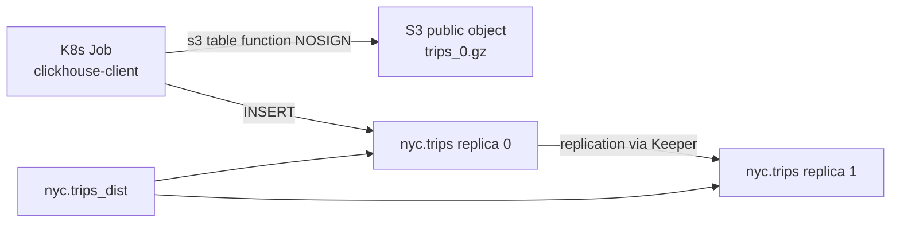
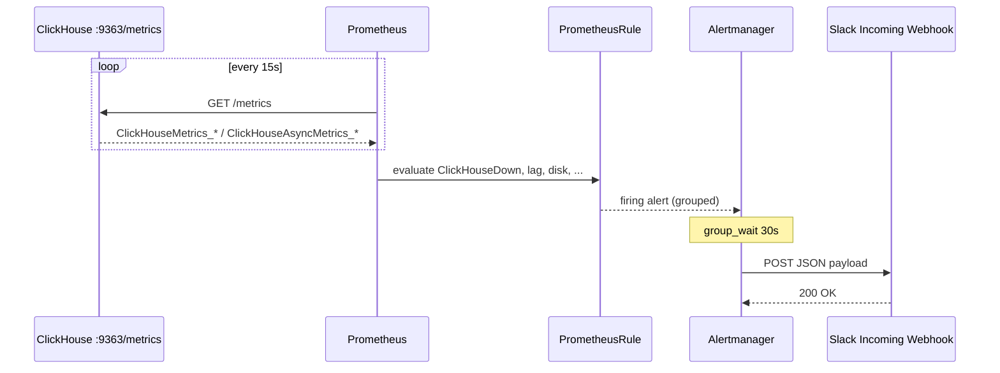

# How the localhost ClickHouse Kubernetes lab works

This document is the narrative for a blog post: what we built, why each piece exists, and how a query or an alert actually travels through the stack.

## 1. The problem this lab answers

You want to **practice a real ClickHouse cluster** (replicas, Keeper, operators, metrics, paging) without renting a cloud Kubernetes account. The cluster has to be:

- Repeatable (one command to create, one command to destroy)
- Close to production shape (CRDs, Helm, Prometheus Operator, Alertmanager)
- Small enough for a laptop
- Documented so a reader can follow along

Ansible is the outer installer so the blog is not a pile of copy-pasted `kubectl` and `helm` commands. Kubernetes remains the source of truth for runtime state.

## 2. Architecture



**Why kind, not minikube or k3d?** kind runs Kubernetes *nodes as Docker containers*. That matches a laptop that already has Docker, and extra port mappings are a first-class feature. k3d would also work; the Ansible `kind_cluster` role is the only piece you would swap.

Rendered copy: [diagrams/architecture.svg](diagrams/architecture.svg).

**Why the Altinity operator?** A ClickHouse cluster is not one Deployment. You need StatefulSets, headless services, config, users, Keeper connection strings, and rolling schema. The operator’s `ClickHouseInstallation` and `ClickHouseKeeperInstallation` CRDs encode that.

## 3. Topology inside ClickHouse



- **Keeper (3 nodes)** stores replication log metadata. Three nodes keep a quorum if one dies. That is the smallest “real” coordination cluster; a 1-node Keeper is fine for a toy but teaches the wrong failure story.
- **ClickHouse (1 shard × 2 replicas)** means every row of `nyc.trips` is stored twice. The blog can kill a pod and still `SELECT`.
- **`nyc.trips_dist`** is a `Distributed` table. Inserts and selects can go through it so the client does not pick a replica by hand.

Macros `{shard}`, `{replica}`, and `{uuid}` are filled in by the operator in each pod’s config.

## 4. What Ansible does, in order



Roles:

| Role | Responsibility |
| --- | --- |
| `prereqs` | Docker is up; `kind` / `kubectl` / `helm` installed |
| `kind_cluster` | Create `clickhouse-lab`, write `.kube/config` |
| `clickhouse_operator` | Helm install operator into `clickhouse` |
| `clickhouse_cluster` | Keeper CR, CHI CR, NodePort services |
| `monitoring` | kube-prometheus-stack + scrape + rules |
| `load_dataset` | Job that runs `load.sql` |

Playbooks are thin on purpose so a reader can run `site.yml` then `load-data.yml` as two blog sections (cluster first, data second).

## 5. Host access (kind extraPortMappings)

kind’s control-plane container publishes NodePorts to localhost:

| Host | NodePort | Service |
| --- | --- | --- |
| 8123 | 30081 | ClickHouse HTTP |
| 9000 | 30090 | ClickHouse native |
| 3000 | 30300 | Grafana |
| 9090 | 30091 | Prometheus |
| 9093 | 30093 | Alertmanager |

HTTP example:

```bash
curl 'http://127.0.0.1:8123/?user=default&password=clickhouse' \
  --data-binary "SELECT fqdn(), currentUser()"
```

## 6. Dataset: NYC taxi (`trips_0.gz`)

Source (public, no AWS keys):

[https://datasets-documentation.s3.eu-west-3.amazonaws.com/nyc-taxi/trips_0.gz](https://datasets-documentation.s3.eu-west-3.amazonaws.com/nyc-taxi/trips_0.gz)

This is the same family of files used in [ClickHouse’s S3 documentation](https://clickhouse.com/docs/integrations/s3): tab-separated, gzipped, about **one million trips** per file. The lab loads **one file** so a laptop ingest stays in minutes, not hours. There are more files (`trips_1.gz` …) if you want to scale the story.



The load SQL:

1. `CREATE DATABASE nyc ON CLUSTER 'lab'`
2. `ReplicatedMergeTree` table `nyc.trips` on the cluster
3. `Distributed` table `nyc.trips_dist`
4. `INSERT INTO nyc.trips SELECT … FROM s3(..., NOSIGN, 'TabSeparatedWithNames')`

`NOSIGN` is required for this public bucket (anonymous access). Types are coerced with `coalesce` / `toFloat*OrZero` because the TSV infers several fare columns as strings.

Sanity queries after `make load-data`:

```sql
SELECT count() FROM nyc.trips_dist;

SELECT
    toYear(pickup_date) AS year,
    round(avg(fare_amount), 2) AS avg_fare,
    count() AS trips
FROM nyc.trips_dist
GROUP BY year
ORDER BY year;

SELECT
    pickup_ntaname,
    count() AS trips
FROM nyc.trips_dist
WHERE pickup_ntaname != ''
GROUP BY pickup_ntaname
ORDER BY trips DESC
LIMIT 10;
```

Replication check (run against HTTP; both replicas should report a similar `total_replicas`):

```sql
SELECT
    database,
    table,
    is_leader,
    total_replicas,
    active_replicas
FROM system.replicas
WHERE table = 'trips';
```

## 7. Monitoring and Slack



ClickHouse 25.x exposes Prometheus on port **9363** (`prometheus/port` in the CHI settings). Keeper exposes **7000**. `ServiceMonitor` objects tell the Prometheus Operator to scrape those Services; we set `serviceMonitorSelectorNilUsesHelmValues: false` so monitors in the `clickhouse` namespace are picked up.

### Alert catalog

| Alert | When it fires | Severity |
| --- | --- | --- |
| `ClickHouseDown` | `up{job="clickhouse-http"} == 0` for 2m | critical |
| `ClickHouseKeeperDown` | Keeper scrape (`job="keeper-metrics"`) fails for 2m | critical |
| `ClickHouseReplicaReadonly` | `ReadonlyReplica > 0` for 5m | critical |
| `ClickHouseDelayedReplicas` | absolute replica delay > 30s | warning |
| `ClickHouseLowDisk` | default disk < 15% free | warning |
| `ClickHouseRejectedInserts` | rejected inserts in 5m | warning |

Grafana ships a **ClickHouse lab** dashboard (`uid: clickhouse-lab`) with scrape health, query load, and replica delay. Open Grafana → Dashboards → ClickHouse lab.

### Slack wiring

Full click-by-click webhook instructions: [slack-setup.md](slack-setup.md).

Alertmanager lives in kube-prometheus-stack. The Helm values set `global.slack_api_url` from `ansible/inventory/group_vars/secrets.yml` (gitignored). Receivers:

- No webhook → default receiver `noop` (alerts still visible in the Alertmanager UI)
- Webhook present → receiver `slack` for `severity =~ "warning|critical"`

**Do not put the webhook in git.** Rotate it in the Slack app if it leaks.

End-to-end test without breaking ClickHouse:

```bash
make test-alert
# or: ./scripts/lab.sh test-alert
```

That POSTs a synthetic alert to `http://127.0.0.1:9093/api/v2/alerts`. To test a *real* `ClickHouseDown` alert, scale a replica to zero and wait two minutes:

```bash
export KUBECONFIG="$PWD/.kube/config"
kubectl -n clickhouse scale sts chi-lab-lab-0-0 --replicas=0   # names vary; list sts first
```

## 8. Resource notes for a laptop

The manifests request small CPU/memory (Keeper ~128 Mi, ClickHouse ~512 Mi, Prometheus ~256 Mi). Limits are higher so a bursty ingest does not OOM immediately. Give Docker **8 GB RAM** and **4 CPUs**. If pods sit in `Pending`, `kubectl describe pod` will usually show insufficient CPU or disk (kind uses containerd ephemeral storage).

## 9. Suggested blog outline

1. Hook: “A two-replica ClickHouse cluster on a laptop, with Slack pages.”
2. Diagram from section 2.
3. `make bootstrap` / `make deploy` with a short Ansible explanation.
4. Keeper + CHI YAML walkthrough (link to `k8s/clickhouse/` after first deploy).
5. Load NYC taxi; show `count()` and one GROUP BY.
6. Grafana + Prometheus screenshots (`up`, `ClickHouseMetrics_Query`).
7. Configure Slack; `make test-alert`; screenshot of the message.
8. Kill a replica; show `system.replicas` and the `ClickHouseDown` alert.
9. `make teardown`.

## 10. What this is not

- Not a production security baseline (plain passwords, `0.0.0.0/0`, no TLS, no network policies).
- Not a HA story for the control plane (kind is a single Docker host).
- Not a substitute for ClickHouse Cloud or a tuned on-prem cluster (storage is local PVs inside kind).

The value is a **faithful control-plane and data-plane shape** you can smash and rebuild in an afternoon.

## 11. Measured on the reference laptop

These numbers came from `./scripts/lab.sh verify` and ad-hoc SQL after a successful deploy (not placeholders):

- **1,000,660** rows in `nyc.trips` on each replica and in `nyc.trips_dist`
- Sample is **2015** trips, average fare **13.20**
- Grafana dashboard UID `clickhouse-lab` is loaded (sidecar ConfigMap)
- Slack: webhook applied; Alertmanager routes lab alerts to receiver `slack` (`#all-notifications`)

