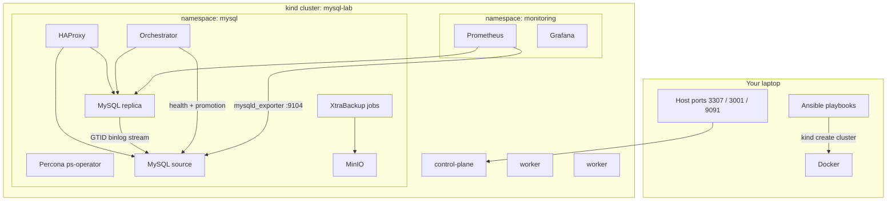

# How the localhost MySQL replication Kubernetes lab works

This document is the narrative for a blog post: what we built, why each piece exists, and how a write, a failover, a backup, and a scale-out actually travel through the stack.

Measured command output from the 2026-09-10 lab run lives in [blog-draft.md](blog-draft.md) (10 tables, 471–493 MB, force-delete failover with former source rejoin IO/SQL `ON`, MinIO backup `Succeeded`, scale-out to 3). Cluster layout and SQL live in [cluster-and-data.md](cluster-and-data.md).

## 1. The problem this lab answers

You want to **practice classic MySQL source–replica replication** (GTID, automated failover, backups you can restore, Prometheus) without renting a cloud Kubernetes account. The cluster has to be:

- Repeatable (one command to create, one command to destroy)
- Classic **async binlog/GTID replication**, not Galera/wsrep and not Group Replication
- Small enough for a laptop
- Documented so a reader can follow along, with numbers from a real run

Ansible is the outer installer. Kubernetes remains the source of truth for runtime state.

## 2. Architecture



**Why Percona Operator (ps-operator), not PXC?** The PXC operator is Galera. This lab needs a writable **source** and replicas that apply the source's **binary log / GTID** stream. `mysql.clusterType: async` plus Orchestrator is that topology. Group Replication is also not used here.

**Why kind?** Same reason as the sibling ClickHouse lab: Kubernetes nodes as Docker containers, extra port mappings as a first-class feature.

## 3. Data path

1. Ansible `load-data` creates database `sbtest` on the current source.
2. A Kubernetes Job runs `sysbench oltp_read_write prepare` with **10 tables** and `table-size=200000`, aimed at **about 500MB** of InnoDB data (documented band 400–700MB).
3. Replicas apply the binlog until `information_schema` shows the same 10 `sbtestN` tables.

## 4. Failover path

1. Orchestrator polls MySQL instances.
2. The failover playbook **force-deletes** the current source pod (`kubectl delete pod --force --grace-period=0`) so it is unreachable, then curls Orchestrator `GET /api/recover/<host>/3306`.
3. Orchestrator promotes a replica to writable source (`@@read_only=0`).
4. The StatefulSet recreates the old pod. The playbook waits until that member is Running, `@@read_only=1`, replica IO/SQL `ON`, and `replication_connection_configuration.HOST` contains the new source.

## 5. Backup and whole-cluster restore

1. Scheduled XtraBackup (hourly) plus an on-demand `PerconaServerMySQLBackup` named `lab-ondemand`.
2. Backup streams to in-cluster MinIO (`s3` storage, path-style).
3. Restore playbook inserts a **canary table** after the backup, then applies `PerconaServerMySQLRestore`.
4. After restore the canary must be gone and the 10 sysbench tables must still be present.

## 6. Scale-out

Patch `spec.mysql.size` from 2 to 3. The operator provisions a new replica, clones/catches up, and the scale-out playbook asserts replica IO/SQL threads plus 10 sysbench tables on the new member.

## 7. Monitoring

Each MySQL pod runs a `mysqld_exporter` sidecar on `:9104`. A `ServiceMonitor` named `mysql` is scraped by kube-prometheus-stack. Grafana dashboard uid `mysql-lab` shows `up{job="mysql"}`, `mysql_up`, replica lag, and questions.

## 8. Commands

```bash
make bootstrap
make deploy
make load-data
make verify
make failover
make backup
make restore
make scale-out
make teardown
```
