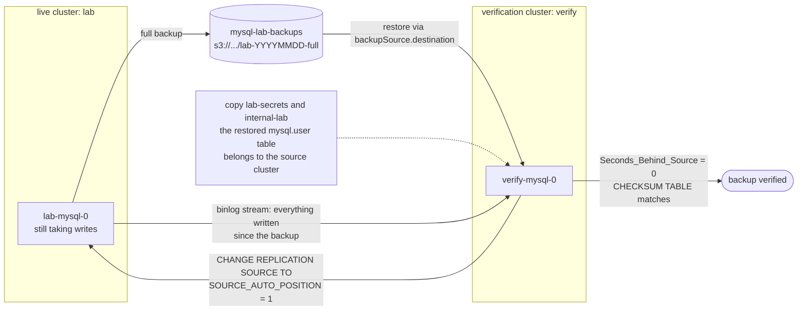

# Test your MySQL backup by restoring it as a replica

A backup job that reports `Succeeded` has proven that the backup process finished. It has not proven that you can recover the database.

The test that settles recoverability, without taking production down, is this: restore the backup into a *separate* cluster, attach that cluster as a replica of the live source, let it catch up, and compare the data. If the backup was incomplete or internally inconsistent, replication refuses to start, or it applies a transaction onto a row the backup does not actually contain and stops with an error. If the restored copy catches up and the tables match, you have a usable database — and, incidentally, a standby.

This post walks through that test as we ran it. The live source kept taking writes. The verification cluster was disposable.

## What this lab is

Local **kind** Kubernetes, **Percona Operator for MySQL 1.2.0**, **Percona Server 8.4.10-10.1**, async GTID replication (one source, one replica), **XtraBackup** into in-cluster **MinIO**. The dataset is sysbench `oltp_read_write` prepare: **10 tables × 200,000 rows**. PITR uses a binlog server streaming to a second MinIO bucket. Orchestrator is installed and is not this post's subject.

Twelve Ansible scenarios surround the backup path. They are grouped in the [catalogue](test-catalogue.md) as:

| Group | Scenarios | What they establish |
| --- | --- | --- |
| Backups are produced | t01–t06 | Objects exist, on demand and on a schedule, from the right pod, and old ones get pruned |
| Backups restore | t07–t11 | Data comes back — whole, after a drop, and to a chosen point in time — and a bad request fails instead of lying |
| **Backups are usable** | **t12** | **The restored copy replicates from the live source, catches up, and matches** |

This post is about the third group. The first two are necessary machinery; they are not the proof. How the operator actually backs up, restores, and replays binlogs is in [backup-architecture.md](backup-architecture.md). Measured runs live in [results/](results/).

## Picture the test

The verification cluster never talks to the source backup custom resource. It reads the XtraBackup object from MinIO, starts as its own MySQL instance, then replicates everything written *since* that backup.



The MinIO node label is schematic. The measured t12 object on the validation run is `s3://mysql-lab-backups/lab/lab-2026-09-12-10:36:24-full`. Source: [`docs/diagrams/restore-as-replica.mmd`](diagrams/restore-as-replica.mmd). Backup creation and binlog streaming: [`architecture.mmd`](diagrams/architecture.mmd). Physical restore plus binlog replay: [`pitr.mmd`](diagrams/pitr.mmd).

## Restore the backup as a replica

The lab scenario is `t12` (`ansible/roles/t12_restore_as_replica/`). It does not depend on an earlier backup; it takes its own full base.

### 1. Take a full backup and keep both destination and storage

A backup is a `PerconaServerMySQLBackup`. When it finishes, `status.destination` is the object-storage path a *different* cluster can restore from, and `status.storage` is the S3 definition the operator used — including `prefix`.

On the ordered validation run the t12 base was:

```
BASE_BACKUP=t12-base
BASE_DESTINATION=s3://mysql-lab-backups/lab/lab-2026-09-12-10:36:24-full
```

(from [results/20260912T101400Z-validation-run.md](results/20260912T101400Z-validation-run.md)). Do not hand-edit that destination into a restore and then invent a storage block that only names the bucket. This operator locates the backup using the storage definition. The t12 role copies `status.storage` wholesale:

```yaml
apiVersion: ps.percona.com/v1
kind: PerconaServerMySQLRestore
metadata:
  name: t12-restore
spec:
  clusterName: verify
  backupSource:
    destination: s3://mysql-lab-backups/lab/lab-2026-09-12-10:36:24-full
    storage:
      type: s3
      s3:
        bucket: mysql-lab-backups
        credentialsSecret: minio-backup-credentials
        prefix: lab
```

There is no `backupName: t12-base`. That field would point at a backup CR on the *source* cluster. Cross-cluster restore is `backupSource.destination` plus the original storage metadata. Supplying the bucket alone makes this operator search the wrong object prefix.

The second shakeout recorded the failure mode in [results/shakeout2-run.md](results/shakeout2-run.md): t12 **FAILED** in 37s with `backup not found in storage`.

### 2. Copy the source credentials, including the secrets you did not create

The restored datadir contains the source cluster's `mysql.user` table. A brand-new `verify` cluster gets brand-new generated passwords. The moment its datadir is replaced, those passwords are wrong. The operator cannot log in to the database it has just restored. The failure looks like a crash-loop or a stuck restore — which reads like a corrupt backup.

Copy three secrets, not one:

```
COPIED lab-secrets -> verify-secrets
COPIED internal-lab -> internal-verify
COPIED lab-ssl -> verify-ssl
```

`lab-secrets` is the user-facing secret. `internal-lab` is operator-generated and holds `operator`, `replication`, `monitor`, `orchestrator`, `heartbeat`, and `xtrabackup`. Copying only the user secret is not enough. `lab-ssl` is the TLS material the later `SOURCE_SSL=1` replication channel needs; the t12 role copies it when it exists. This is a laptop lab with intentionally simple credentials, not a production secret-management pattern.

### 3. Create a disposable one-node cluster

`verify` is a `PerconaServerMySQL` with `mysql.size: 1`, HAProxy off, Orchestrator off, PITR off (`ansible/roles/t12_restore_as_replica/templates/verify-cluster.yaml.j2`). It exists to restore into and replicate from. It is not a second production topology.

### 4. Restore, then write a marker the backup cannot contain

After requesting the restore, t12 writes a unique table of **20,000** rows on the *live* source. Those rows are newer than the backup.

Before replication starts, the restored copy must not have them. The validation run recorded:

```
WRITES_AFTER_BACKUP=20000
RESTORE_STATE=Succeeded
RESTORED_TABLES=10
RESTORED_POST_BACKUP_ROWS=0
RESTORE_SECONDS=65
```

`Succeeded` here means the restore job finished. The marker assertion is what proves the restored datadir is actually that backup, not an already-caught-up copy.

### 5. Require a distinct identity, then replicate with auto-position

The restored instance must not share the source's `server_uuid` or `server_id`. Measured:

```
SERVER_UUID live=71463f98-ae95-11f1-aeda-1e96d50fb941 restored=e55cafc3-ae95-11f1-a099-1e881dd5cec9
SERVER_ID live=35921690 restored=39133310
RESTORED_GTID_PURGED=5fccd34e-ae85-11f1-a9d5-0e01098e2e59:1-925,71463f98-ae95-11f1-aeda-1e96d50fb941:1-55,a84e643f-ae94-11f1-8ddd-2ec4c43ab3c3:1-52,d97cef97-ae93-11f1-ba46-16c9a8133dba:1-71,f25e09c8-ae91-11f1-b5a6-72d21a7478f2:1-214
```

XtraBackup restored `gtid_purged` with the data. The replica already knows which transactions it contains. No binlog filename, no offset:

```sql
CHANGE REPLICATION SOURCE TO
  SOURCE_HOST='lab-mysql-0.lab-mysql.mysql.svc.cluster.local',
  SOURCE_PORT=3306,
  SOURCE_USER='replication',
  SOURCE_PASSWORD='…',
  SOURCE_SSL=1,
  SOURCE_AUTO_POSITION=1;
SET GLOBAL super_read_only=ON;
START REPLICA;
```

(`SOURCE_HOST` is the validation-run value. The password comes from `internal-lab`'s `replication` key.)

### 6. Catch up, then compare data — lag is not the pass criterion

t12 waits until both replication threads are running *and* `Seconds_Behind_Source` is 0, then it still does more work: `WAIT_FOR_EXECUTED_GTID_SET` against the source watermark, a GTID-gap measurement, the 20,000-row marker on both sides, `COUNT(*)` = 200,000 on all ten sysbench tables, and `CHECKSUM TABLE` with zero mismatches.

Validation t12:

```
Replica_IO_Running: Yes
Replica_SQL_Running: Yes
Seconds_Behind_Source: 0
CATCHUP_SECONDS=12
GTID_GAP_REPLAYED=71463f98-ae95-11f1-aeda-1e96d50fb941:56-155
GTID_GAP_TRANSACTIONS=100
LIVE_POST_BACKUP_ROWS=20000
REPLICA_POST_BACKUP_ROWS=20000
ROWS sbtest1 live=200000 replica=200000
CHECKSUM sbtest1 live=2265383791 replica=2265383791
CHECKSUM_MISMATCHES=0
VERIFY_RESOURCES_REMAINING=0
```

sbtest2 through sbtest10 likewise matched. Zero seconds of lag means the replica has applied what it has seen. Matching checksums and the post-backup marker mean it applied the *right* history onto the *right* backup.

A green restore job cannot give you these four proofs:

1. the datadir was complete and internally consistent — InnoDB recovered and started;
2. `gtid_purged` was accurate — auto-position asked for the right subsequent transactions;
3. transactions written after the backup apply cleanly — the backup is an ancestor of live, not a divergent branch;
4. the result is byte-comparable with the source — `CHECKSUM TABLE` matches.

Cleanup deletes `verify`, the restore object, the copied secrets, and the PVCs. PASS is recorded only after that and a source health check. The live cluster is still `PRIMARY=lab-mysql-0` with `REPLICA_OK=1`.

## Pitfalls that look like a bad backup

- **Secret copy.** If `verify` starts with its own generated passwords, restore authentication fails and the backup looks corrupt. Copy `lab-secrets`, `internal-lab`, and `lab-ssl`. Laptop credentials; not a production pattern.
- **Storage prefix.** `s3://mysql-lab-backups/lab/lab-2026-09-12-10:36:24-full` still fails if the restore's S3 definition omits `prefix: lab`. Preserve `backup.status.storage`. Shakeout2 t12: `backup not found in storage`.
- **Identities.** Distinct `server_uuid` and `server_id` are asserted before `START REPLICA`.
- **`Succeeded` is not recoverability.** The restore object in this run reached `RESTORE_STATE=Succeeded` at 65 seconds. The scenario was not done. Catch-up, GTID gap, marker, checksums, cleanup, and source health are the rest of the proof.

## Reproduce it

From `20260911-mysql-replication-backups/`:

```bash
./scripts/lab.sh bootstrap
./scripts/lab.sh deploy
./scripts/lab.sh load-data
RUN_ID=my-validation ./scripts/lab.sh test-backups
RUN_ID=my-validation ./scripts/lab.sh report
```

The suite is destructive to this local lab: several scenarios rewind the source. Run only the restore-as-replica scenario with `./scripts/lab.sh t12` (it takes its own base). `./scripts/lab.sh t01` through `t11` observe the catalogue's backup prerequisites. `./scripts/lab.sh test` is the offline configuration check.

The validation wrap-up also passed all **35** [offline tests](results/20260912T101400Z-validation-offline-tests.log) (`Ran 35 tests in 0.196s`) and [cluster verification](results/20260912T101400Z-validation-health.log) (`replica_io=ON replica_sql=ON`, `Prometheus mysql up ok`). The [environment snapshot](results/20260912T101400Z-validation-environment.json) records image digests, Kubernetes version, and PITR archive configuration.

## Supporting context — the rest of the suite

All twelve scenarios passed in one ordered run on 12 September 2026. Total recorded scenario time: **1472 s**. These are local-lab timings including waits and checks, not a production benchmark.

| Scenario | Duration |
| --- | --- |
| t01 — On-demand full backup to MinIO | 27 s |
| t02 — Backup taken from the replica, primary untouched | 14 s |
| t03 — Incremental backup on a full base | 19 s |
| t04 — Backup and binlog objects present in MinIO | 40 s |
| t05 — Scheduled backup runs unattended | 207 s |
| t06 — Retention prunes scheduled backups down to keep | 11 s |
| t07 — Whole-cluster restore rolls back post-backup writes | 161 s |
| t08 — Restore recovers a dropped table | 160 s |
| t09 — Point-in-time recovery to a timestamp | 355 s |
| t10 — Point-in-time recovery to a GTID | 336 s |
| t11 — An impossible recovery target fails cleanly | 24 s |
| t12 — Restore into a new cluster, attach as a replica, catch up | 118 s |

t06's 11 s measures pruning and verification against scheduled backups that already existed from earlier development runs, not the creation of three fresh backups. The removed data prefix was empty; sibling MD5 sidecar `lab-2026-09-12-09:06:38-full.md5` remained.

**PITR date format.** This binlog-server build accepts UTC timestamps as `YYYY-MM-DDTHH:MM:SS` with **no timezone suffix**. A sample `Z` suffix produces `Invalid timestamp format`. The validation t09 target was `2026-09-12T10:25:07`. t11 asked for `2001-01-01T00:00:00` (valid format, before any backup) and failed with `Timestamp is too old` (`RESTORE_STATE=Error`).

**Recovery-history isolation.** After an in-place restore, the old binlog archive can still contain transactions from the discarded history. Shakeout2 t09: markers were correct (`GOOD_AFTER_RESTORE=1`, `BAD_AFTER_RESTORE=0`) but `TABLES_AFTER_RESTORE=9` — an earlier test's `DROP TABLE` had been replayed. Each PITR scenario now starts a fresh archive prefix before its base backup.

**GTID capture.** The MySQL batch client escapes embedded newlines unless raw output is requested. Shakeout2 t10 failed with `cannot parse GTID set`. A later targeted run failed with `The specified GTID set cannot be covered` when a fresh archive was asked to cover inherited GTIDs from an older backup. t10 now captures GTIDs with `--raw` and requests the GTID difference for the current recovery history.

**Incremental backups.** t03 created an incremental on t01's full base: `FULL_BYTES=708418853`, `INCR_BYTES=15510469`, `INCR_PCT_OF_FULL=2`. That proves creation and relative size. It does not prove that restoring an incremental chain works. That would be its own restore-and-compare scenario. The lab does not run one.

**Test the test.** An expected failure must fail for the intended reason. t11 originally could pass on a timestamp-format error; it now requires a range/search rejection (`Timestamp is too old`) and compares the dataset before and after. Retention must remember observed destinations and check pruned prefixes in MinIO; leftover MD5 sidecars are reported, not described as full deletion.

## Takeaway checklist

- Do not treat backup CR `state: Succeeded` as recoverability.
- Restore into a *separate* cluster so the source keeps running.
- Point the restore at object storage (`backupSource.destination`), not at the source cluster's backup CR name.
- Preserve `status.storage` from the successful backup, including the S3 `prefix`.
- Copy the restored `mysql.user` credentials: user secret, operator `internal-<cluster>` secret, and TLS secret if replication uses SSL.
- Assert `server_uuid` and `server_id` differ from the live source before `START REPLICA`.
- Confirm `gtid_purged` is populated; use `SOURCE_AUTO_POSITION=1` (no binlog coordinates).
- Write a post-backup marker on the live source; it must be absent on the restore and present after catch-up.
- Require `Replica_IO_Running: Yes`, `Replica_SQL_Running: Yes`, *and* matching `COUNT(*)` / `CHECKSUM TABLE` — not lag alone.
- Record restore duration, catch-up duration, and the GTID gap you replayed.
- Destroy the verification cluster; confirm the source is still healthy.
- Give every backup schedule a matching restore-test schedule.
- Do not claim an incremental restore works because an incremental backup was smaller than its full base.
- For PITR on this operator/binlog-server build: timestamps are `YYYY-MM-DDTHH:MM:SS` with no `Z`, and each recovery history needs its own archive prefix.

## What the evidence cannot claim

A restored replica that catches up and matches the source is strong evidence that **this** backup and replication path work for **this** dataset (10×200,000-row sysbench, laptop kind cluster, operator 1.2.0). It does not replace application-level checks, production-scale timing, or testing other backup generations.

It does not prove incremental-chain restore. It does not prove Orchestrator failover. Durations (restore **65 s**, catch-up **12 s**, scenario **118 s**, suite scenario-time **1472 s**) are local-lab timings including waits and checks, not an RTO target.

Restore, catch up, verify, record the result, repeat on a schedule.
