# High availability for MySQL asynchronous replication

**Krzysztof Książek**, senior MySQL DBRE (ex-Severalnines, ex-Pythian).

This is a hands-on lab for people who have used MySQL and have not yet run a failover. Highly available, in this lab, means the application keeps a single address and writes resume after the server that was taking them dies. You will build that on your laptop, break it on purpose, and see what the application experiences.

The numbers, command output, and screenshots are from a real run on 2026-10-19. Nothing here is mocked.

## What you will build

One MySQL server that accepts writes (the **source**), two servers that copy its data (the **replicas**), a proxy in front so the application has a single address, and a failover tool that picks a new source when the old one disappears.

```text
your app (sysbench)
        |
        v
    ProxySQL          the only address the app knows
        |
        +-- mysql-1   source, takes the writes
        +-- mysql-2   replica
        +-- mysql-3   replica

Orchestrator watches all three.
When mysql-1 dies, Orchestrator promotes mysql-2
and tells ProxySQL to send writes there.
```

A diagram with the same pieces is in [The picture](#the-picture).

You can build it in one command, or type every step yourself. Both paths end at the same containers.

```bash
./scripts/lab.sh deploy      # build everything
./scripts/lab.sh verify      # check the healthy starting state
./scripts/lab.sh teardown    # delete containers, volumes, and the network
```

`make deploy`, `make verify`, and `make teardown` do the same thing. The typed-out version, with the expected output after every step, is [docs/manual-setup.md](docs/manual-setup.md).

## What you will learn

- What asynchronous replication is, and what a GTID is for.
- Why replicas are put into `read_only` and `super_read_only`.
- How ProxySQL decides which server receives a query (hostgroups, the monitor, query rules).
- What Orchestrator does during a crash, and how a small hook points ProxySQL at the new source.
- How to read a sysbench line (`tps`, `qps`, `err/s`, `reconn/s`) and use it to see a stall.
- What your application feels when the source dies, when a replica dies, and when you send reads to the replicas and then lose them.

## Before you start

| | |
| --- | --- |
| Operating system | Linux or macOS. The write-up was produced on Ubuntu 24.04.5. |
| Docker Engine | 29.1.3 on that host. Any current Docker Engine with the `docker compose` plugin works. Compose on the host was 2.40.3. |
| Memory | About **4 GB free** for Docker. Each MySQL uses a 128 MB buffer pool; three of them plus ProxySQL, Orchestrator, and sysbench still need a few gigabytes once caches and images are counted. |
| CPU | 2 cores is enough. The host used here had 4. |
| Tools | `curl` and `python3`. `sudo` only if the Linux firewall check in the deploy script needs it. |
| Time | The first run pulls images. After that, a clean deploy takes about a minute on this host. |

Ports on your machine. They sit above the other labs in this repository so two labs can run together.

| What | Address on your machine | Login |
| --- | --- | --- |
| Application MySQL (ProxySQL) | `127.0.0.1:16033` | `sbuser` / `sbpass` |
| ProxySQL admin | `127.0.0.1:16032` | `radmin` / `radmin` |
| ProxySQL web page | `https://127.0.0.1:16080/` | `stats` / `stats` |
| Orchestrator web page | `http://127.0.0.1:13000/` | no login |
| mysql-1, mysql-2, mysql-3 | `127.0.0.1:13316`, `:13317`, `:13318` | `root` / `mysql` |

Open the ProxySQL page with `https`. Plain `http://` on port 6080 returns an empty reply. The browser will ask for a username and password (HTTP digest, realm `Access to ProxySQL status page`). That user is `stats` / `stats`. `radmin` / `radmin` is only for the admin port 16032. The built-in `admin` / `admin` user also exists, but ProxySQL accepts it only from inside the container (`docker exec proxysql mysql -h127.0.0.1 -P6032 -uadmin -padmin`); from your machine it fails with `ERROR 1040 ... can only connect locally`.

Other accounts, all with the password equal to the username: `repl` (replication), `orchestrator` (the failover tool), `monitor` (ProxySQL's health checks). They are created in the manual.

This lab uses plain-text passwords and no TLS. That is deliberate, so you can read every command. Do not copy the files onto a real server. [What is different in production](#what-is-different-in-production) says what you would change.

If `docker version` fails, the host used for this write-up had no Docker service. The packages that worked there were `docker.io` and `docker-compose-v2`, and `dockerd` had to be started by hand. Details are in [When something goes wrong](#when-something-goes-wrong).

## The picture

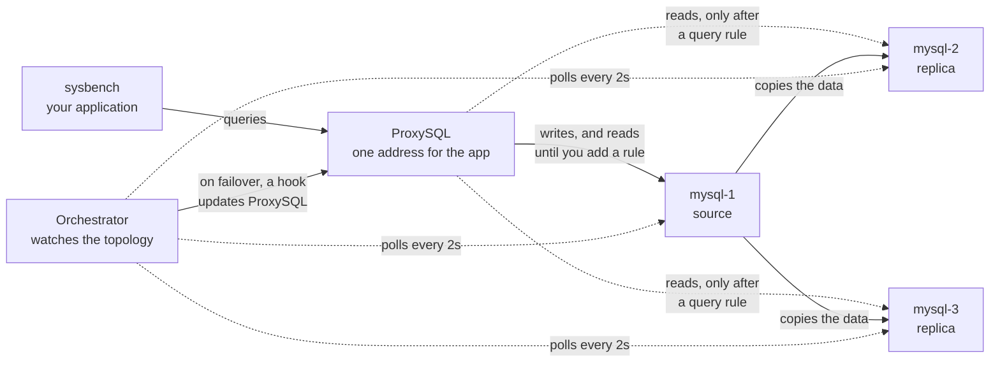

Solid arrows are the path you get from `deploy`. The dotted arrows from ProxySQL to the replicas appear only after experiment C adds a rule. Orchestrator is always watching, even while the app talks only to ProxySQL.

## Ideas you need first

You can skip a subsection and come back when a later step uses the word.

### The source copies its changes to the replicas, after the fact

MySQL replication in this lab is **asynchronous**. The source writes the change to its own disk, tells the client "committed", and only then do the replicas pull that change and apply it. The replicas are usually a fraction of a second behind. They can be further behind if they are slow or stopped.

That gap is the tradeoff. The client is not waiting for a replica. If the source dies in the gap, a transaction the client was told had committed can be missing on the new source. This lab does not measure that gap by reopening the dead server's files. [Production](#what-is-different-in-production) mentions semi-sync, which waits for one replica to receive the change before the client is told the commit succeeded.

Each change is written to a file on the source called the **binary log**, and labelled with a **GTID** (global transaction identifier): the source's id, plus a counter (`server-uuid:1-16` and so on). A replica remembers which GTIDs it has already applied. When it connects, it asks the source for the rest, so you do not have to tell it which binary-log file to start at. The lab turns this on with `gtid_mode=ON` and attaches replicas with `SOURCE_AUTO_POSITION=1`.

MySQL 8.4 renamed the old replication commands. You will type `CHANGE REPLICATION SOURCE TO` and `SHOW REPLICA STATUS`. The older words `MASTER` and `SLAVE` were removed. Orchestrator's web page and log still say "master" for the writable server. In this write-up that server is the source.

### Replicas refuse writes

`read_only=ON` makes a normal account's writes fail. A replica with `read_only` left off can be written to by mistake, and those rows never reach the other servers.

`super_read_only=ON` does the same for accounts that have the `SUPER` privilege, including `root`. Orchestrator turns both off in memory when it promotes a replica. The config file on disk still says `ON`. Restarting that container brings the new source back read-only until someone clears the variables. That footgun is called out again after the failover experiment.

### ProxySQL is a bucket of servers, plus a health check

The application connects to ProxySQL, not to mysql-1. ProxySQL keeps lists of MySQL servers called **hostgroups**. A hostgroup is just a number:

| Number | Role in this lab |
| --- | --- |
| 10 | Writer. The server here has `read_only=0`. Application writes go here. |
| 20 | Readers. Servers here have `read_only=1`. Reads go here only if a rule says so. |
| 30 | Quarantine. The failover hook tries to park a dead source here so it cannot take writes. |

The **monitor** is a ProxySQL thread that logs in as `monitor` and asks each server for `read_only`. A server that answers `0` is placed in hostgroup 10. A server that answers `1` is placed in hostgroup 20. You insert all three servers into hostgroup 10 at the start; within a second or two the monitor moves the replicas to hostgroup 20. You will see that move in the manual.

The monitor also pings. After two failed pings (`shun_on_failures=2`, once a second) ProxySQL marks the server **SHUNNED** and stops sending it queries. SHUNNED means "I tried, and I will not use you until you look healthy again."

A **query rule** is a pattern match on the statement text. This lab's later experiment adds one rule: if the statement starts with `SELECT`, send it to hostgroup 20. Rules run only when ProxySQL can see the text. Two lab settings matter:

- `transaction_persistent=1` on the user `sbuser`. The first statement of a transaction picks a server, and the rest of that transaction stays there. `oltp_read_write` starts with `BEGIN`, which goes to hostgroup 10, so the `SELECT`s inside that transaction stay on the writer. The rule does not split them.
- `--db-ps-mode=disable` on sysbench. The default uses prepared statements. ProxySQL pins a prepared statement to a server when it is prepared, and does not look at the text again. The text protocol lets the rule see `SELECT`.

`LOAD ... TO RUNTIME` is the step that makes an admin change take effect. `SAVE ... TO DISK` keeps it across a ProxySQL restart. You will run both.

The ProxySQL web page draws connection graphs. It does not draw the hostgroup table or the rule-hit counter. Those are SQL on the admin port, and the terminal screenshots below are that SQL.

### Orchestrator promotes a replica and then calls a hook

Orchestrator logs into every MySQL server, draws the topology, and notices when the source stops answering. With the lab's settings that takes about two seconds (`InstancePollSeconds=2`, connect timeout 1 second). It then:

1. Chooses a replica. The config prefers mysql-2, accepts mysql-3, and refuses any other host (`must_not`), so the old source is not chosen if it reappears.
2. Turns `read_only` and `super_read_only` off on the chosen replica.
3. Points the surviving replica at the new source, using GTIDs.
4. Runs the hook `proxysql-failover-hook.sh`.

Orchestrator 3.2.6 has no built-in "edit ProxySQL hostgroups" feature. The hook is the supported way to extend it (`PostMasterFailoverProcesses` in the config). The hook writes to ProxySQL's admin port as `radmin`: it tries to park the dead source in hostgroup 30, and it inserts the new source into hostgroup 10. The measured failover section shows what ProxySQL's runtime table actually contained a few seconds later.

The image is Percona's build of Orchestrator 3.2.6, not the older upstream build. The upstream build still emits the MySQL commands that 8.4 removed, so it cannot discover these servers.

### How to read a sysbench line

sysbench is a load generator. `oltp_read_write` is a mix of inserts, updates, deletes, and selects, wrapped in a transaction. The lab runs 4 threads against 4 tables of 10 000 rows, and prints one line per second. A healthy line from this host:

```text
01:15:39 [ 582s ] thds: 4 tps: 871.04 qps: 17399.82 (r/w/o: 12178.57/3479.16/1742.08) lat (ms,95%): 6.91 err/s: 0.00 reconn/s: 0.00
```

| Field | Meaning |
| --- | --- |
| `01:15:39` | Clock time. The lab prefixes this so you can line it up with the kill. |
| `[ 582s ]` | How long this sysbench process has been running. |
| `thds` | Threads. 4 for the read/write run, 2 for the read-only run. |
| `tps` | Transactions per second. One `BEGIN` … `COMMIT` is one transaction. |
| `qps` | Queries per second, including the `BEGIN` and `COMMIT`. |
| `r/w/o` | Reads / writes / other, per second. "Other" is mostly `BEGIN` and `COMMIT`. |
| `lat (ms,95%)` | 95% of transactions finished faster than this many milliseconds. |
| `err/s` | Errors per second. `0.00` means the threads succeeded. |
| `reconn/s` | New connections opened per second. A jump means threads lost their connection and came back. |

`--mysql-ignore-errors=all` tells sysbench to count an error in `err/s` and keep going. Without that flag the process exits at the first error, and you never see the recovery line.

A healthy run on this host sat around **770–900 tps**, `err/s` 0, 95th-percentile latency about **7 ms**. Your laptop will land somewhere else. Compare a failure to the lines just before it, not to these numbers.

## Build it

From this directory:

```bash
./scripts/lab.sh deploy
./scripts/lab.sh verify
```

`verify` prints `verify: steady state ok` when mysql-1 is up, both replicas are applying with `super_read_only=1`, ProxySQL's only online writer is mysql-1, Orchestrator knows 3 servers, and the sysbench container is running. After a failover this check fails on purpose, because the writer is no longer mysql-1.

If you want to see each grant and each admin statement, follow [docs/manual-setup.md](docs/manual-setup.md) instead of `deploy`. It is the same procedure, with the output you should see after each stage. A clean run of that page on an empty volume reproduced the steady state: all three servers shared one GTID set (`…:1-16`), the replicas were read-only, ProxySQL split the hostgroups, and Orchestrator reported 3 instances.

Two details worth knowing before you read the manual:

- The replicas are a file copy of the source's data directory, with `auto.cnf` removed. Copying the files keeps the GTID history identical, which is what makes a later promotion safe. Starting three empty MySQL containers would give three unrelated GTID histories, and Orchestrator would refuse to promote.
- The wait for MySQL looks for the log line `MySQL init process done. Ready for start up.` and then runs `SELECT 1`. A ping against the official image succeeds too early, against a temporary server that is about to exit, and the next command then fails with `ERROR 2002`.

## A healthy cluster

Open Orchestrator at `http://127.0.0.1:13000/` and follow the cluster named `mysql-1`.

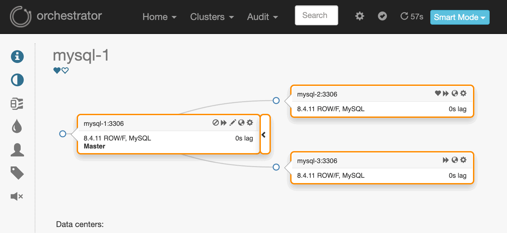

The cluster list is the same fact in one row: one cluster, three servers, recovery enabled.

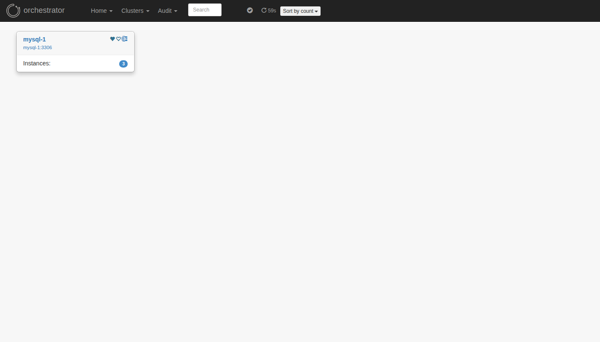

On mysql-2, `SHOW REPLICA STATUS` shows where the copy comes from. Look at `Source_Host` (mysql-1), both thread columns (`Yes` / `Yes`), and `Auto_Position` (`1`, which is the GTID attach).


On the source, `SHOW REPLICAS` lists who is connected. Both replicas should be there, and the performance-schema rows for the receiver and the applier should say `ON`.


ProxySQL's runtime table is the one the application actually uses. Hostgroup 10 contains mysql-1, status `ONLINE`. Hostgroup 20 contains mysql-2 and mysql-3, both `ONLINE`.


The ProxySQL web page is the connection graph, not that table. With sysbench running you should see a handful of client connections and about four server connections. The home page is a summary of the same process.

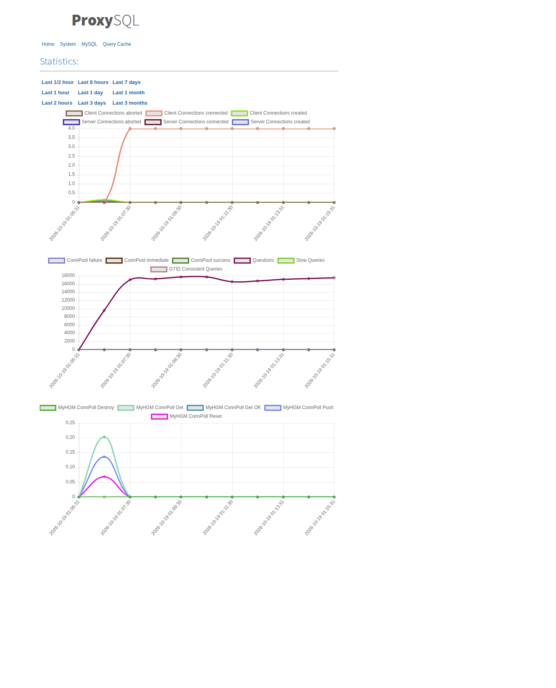

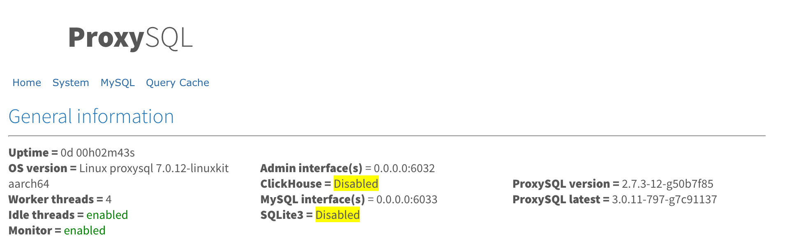

While this is healthy, `docker logs -f sysbench` looks like the sample in [How to read a sysbench line](#how-to-read-a-sysbench-line): hundreds of transactions per second, `err/s` 0, `reconn/s` 0.

## Experiment A: the source dies

**What to expect.** Writes stop for a short time. Orchestrator promotes mysql-2. The surviving replica, mysql-3, starts copying from mysql-2. sysbench shows a couple of seconds at 0 tps, a burst of errors equal to the thread count, then traffic returns. ProxySQL's writer hostgroup changes from mysql-1 to mysql-2.

**How to run it.** Leave sysbench running. In another terminal:

```bash
docker kill mysql-1
```

There is no restart policy, so the container stays stopped (`Exited (137)`). Watch `docker logs -f sysbench`, Orchestrator at `http://127.0.0.1:13000/`, and:

```bash
docker exec proxysql mysql -h127.0.0.1 -P6032 -uadmin -padmin \
  -e "SELECT hostgroup_id, hostname, status FROM runtime_mysql_servers ORDER BY 1,2"
docker logs orchestrator 2>&1 | tail
docker exec orchestrator tail -n 20 /var/log/proxysql-failover.log
```

**What happened at 01:18:57.** Orchestrator's view, one second at a time. `rw` is read/write, `ro` is read-only, `+` means "this replica is attached":

```text
01:18:57 mysql-1 [0s,ok,rw]  + mysql-2 [1s,ok,ro]  + mysql-3 [1s,ok,ro]
01:18:58 mysql-1 [unknown,invalid,rw]  - mysql-2 [null,nonreplicating,ro]  - mysql-3 [null,nonreplicating,ro]
01:18:59 mysql-2 [0s,ok,rw]  + mysql-3 [0s,ok,ro]
```

The hook log is the same second as the promotion:

`DeadMaster` is Orchestrator's name for "the source stopped answering".

```text
2026-10-19T01:18:59+00:00 detected DeadMaster cluster=mysql-1:3306 failed=mysql-1:3306
2026-10-19T01:18:59+00:00 pre-failover DeadMaster cluster=mysql-1:3306 failed=mysql-1:3306
2026-10-19T01:18:59+00:00 hook start type=DeadMaster failed=mysql-1 successor=mysql-2
2026-10-19T01:18:59+00:00 fenced mysql-1 into hostgroup 30
2026-10-19T01:18:59+00:00 successor mysql-2 read_only=0
2026-10-19T01:18:59+00:00 published mysql-2 into writer hostgroup 10
2026-10-19T01:18:59+00:00 post-failover DeadMaster failed=mysql-1 successor=mysql-2:3306
```

sysbench, same clock:

```text
01:18:56 [ 779s ] thds: 4 tps: 888.31 qps: 17773.22 (r/w/o: 12436.36/3560.24/1776.62) lat (ms,95%): 6.67 err/s: 0.00 reconn/s: 0.00
01:18:57 [ 780s ] thds: 4 tps: 430.32 qps: 8597.38 (r/w/o: 6022.47/1714.27/860.64) lat (ms,95%): 9.73 err/s: 0.00 reconn/s: 4.00
01:18:58 [ 781s ] thds: 4 tps: 0.00   qps: 0.00    (r/w/o: 0.00/0.00/0.00)       lat (ms,95%): 0.00 err/s: 0.00 reconn/s: 0.00
01:18:59 [ 782s ] thds: 4 tps: 0.00   qps: 0.00    (r/w/o: 0.00/0.00/0.00)       lat (ms,95%): 0.00 err/s: 4.00 reconn/s: 0.00
01:19:00 [ 783s ] thds: 4 tps: 522.99 qps: 10481.76 (r/w/o: 7337.83/2095.95/1047.98) lat (ms,95%): 4.91 err/s: 0.00 reconn/s: 0.00
01:19:01 [ 784s ] thds: 4 tps: 760.13 qps: 15241.48 (r/w/o: 10674.73/3044.50/1522.25) lat (ms,95%): 5.09 err/s: 2.00 reconn/s: 0.00
01:19:02 [ 785s ] thds: 4 tps: 1021.94 qps: 20420.83 (r/w/o: 14289.17/4087.77/2043.88) lat (ms,95%): 5.67 err/s: 0.00 reconn/s: 0.00
```

Read it against the column guide above. The kill second (01:18:57) still finished 430 transactions, and all 4 threads reconnected (`reconn/s` 4.00). The next two seconds completed nothing. At 01:18:59 each thread recorded one error (`err/s` 4.00). At 01:19:00 traffic was back (523 tps). At 01:19:01 two late errors arrived (`err/s` 2.00) from threads whose next statement still hit the dead server. At 01:19:02 the rate was above the line from before the kill, and `err/s` was 0.

ProxySQL after the hook. Look at hostgroup 10: mysql-2 is `ONLINE` (the new writer) and mysql-1 is `SHUNNED` (ProxySQL will not send it queries). mysql-3 was briefly `SHUNNED` in hostgroup 20 even though replication had already restarted; a later reload put it back to `ONLINE`.

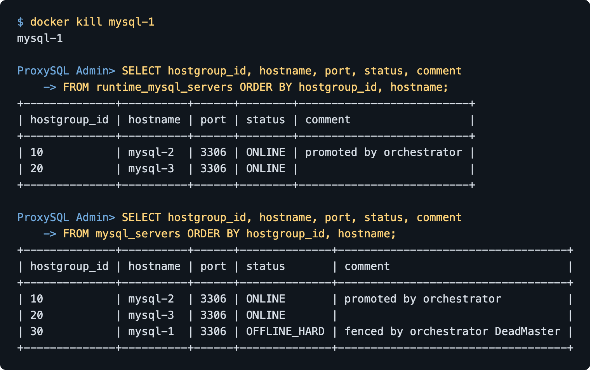

The hook's log says it parked mysql-1 in hostgroup 30 and published mysql-2 into hostgroup 10. Neither happened. In the version of the lab that produced these runs, the hook logged in to ProxySQL as `admin`, and ProxySQL only accepts that user from its own localhost. Both statements were rejected with `ERROR 1040 (42000): User 'admin' can only connect locally`, and the hook wrote its "fenced" and "published" lines without checking. Everything in the table above is ProxySQL's own work: the `read_only` monitor moved mysql-2 into hostgroup 10 and mysql-1 out of the reader role, and the health check shunned mysql-1 because it stopped answering. The shun is what kept writes off the dead server. The process was gone, so it could not have accepted them anyway. The lab now gives the hook its own admin login (`radmin`) and logs `FAILED` when a statement does not apply. A network cut that leaves the old source alive and writable is a different failure, and this run did not perform that cut.

Orchestrator after the promotion. The top node is now mysql-2, read/write. mysql-3 hangs under it. mysql-1 is still drawn, with an invalid last check, because the server never answered again. The page still says "read/write" on that dead node: Orchestrator never got a `read_only` answer after the kill.

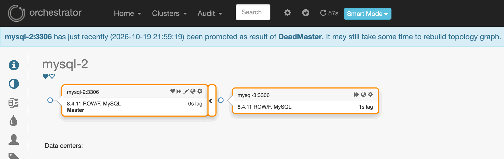

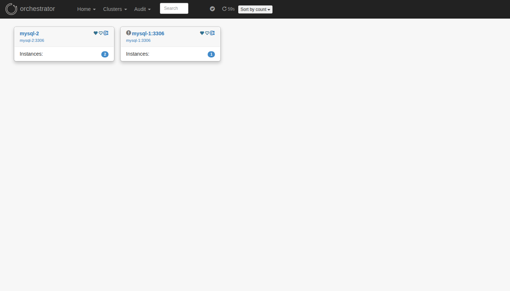

`SHOW REPLICA STATUS` on mysql-2 is empty: it is the source now, with `read_only=0` and `super_read_only=0`. On mysql-3 look at `Source_Host` (mysql-2), both threads `Yes`, `Seconds_Behind_Source` 1, `Auto_Position` 1. The GTID set still contains the old source's transactions (`0167371c-…:1-659315`) plus the new source's (`084bc058-…:1-2912`). Orchestrator moved the replica with GTIDs. It did not rebuild mysql-1.


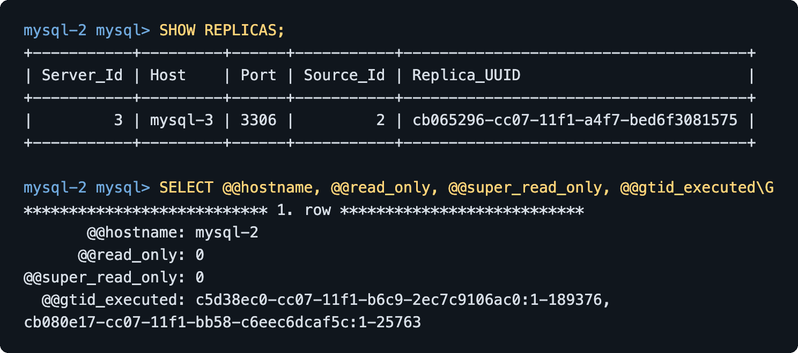

The ProxySQL connection graph across the same minute. Client connections stay (sysbench reconnects into the proxy). Server connections dip while the old writer is unusable and come back once mysql-2 is online.

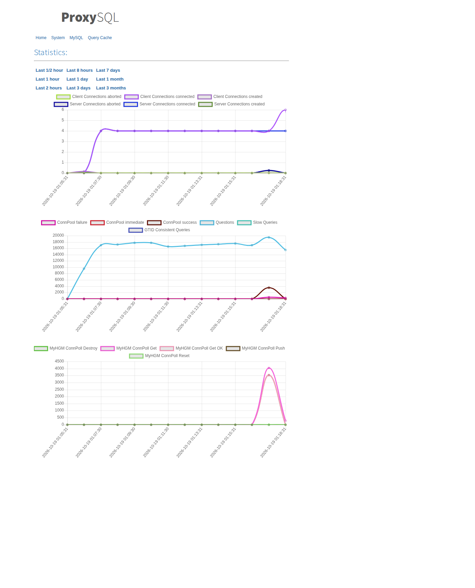

**What this means for your application.** With this lab's timers, a crash of the source is about two seconds of zero throughput and one error per connection, then the application is writing again without anyone changing its host or password. The address it uses is ProxySQL the whole time. Transactions the source committed and the replicas had not yet applied are gone; the killed data directory was not reopened, so that count is unknown. The new source is mysql-2 only until that container restarts: its config file still says `read_only=ON`.

Orchestrator will not run a second automatic failover for one minute (`FailureDetectionPeriodBlockMinutes=1`). The runs below finished, the replicas were started again, and this kill waited that minute out.

## Experiment B: a replica dies, and the app is only using the writer

**What to expect.** Nothing, from the application's point of view. Every `oltp_read_write` transaction is pinned to hostgroup 10. mysql-3 is in hostgroup 20, and nothing in this experiment sends queries there. `tps` should stay in the same band and `err/s` should stay 0. ProxySQL should mark mysql-3 `SHUNNED`.

**How to run it.** This was done before any query rule, and before experiment A, while mysql-1 was still the source.

```bash
docker kill mysql-3
```

**What happened at 01:16:02.**

```text
01:16:02 [ 605s ] thds: 4 tps: 855.82 qps: 17099.32 err/s: 0.00 reconn/s: 0.00
01:16:03 [ 606s ] thds: 4 tps: 1066.98 qps: 21339.67 err/s: 0.00 reconn/s: 0.00
01:16:09 [ 612s ] thds: 4 tps: 809.31 qps: 16152.09 err/s: 0.00 reconn/s: 0.00
```

`err/s` and `reconn/s` stayed 0 through the kill and for the following minute, including after `docker start mysql-3`.

ProxySQL: mysql-1 `ONLINE` in hostgroup 10, mysql-2 `ONLINE` in hostgroup 20, mysql-3 `SHUNNED` in hostgroup 20.


The connect-log rows captured in those same seconds were still the previous successful connects (about 0.4–2 ms, no error text). The error row for this hostname showed up the next time that container was killed, in experiment C: `connect_error = Unknown server host 'mysql-3' (-2)`. `docker kill` removes the DNS name. The monitor's connect fails, the pings are missed, and the server is shunned. The connection graph barely moves, because the writer pool is the one sysbench is using.

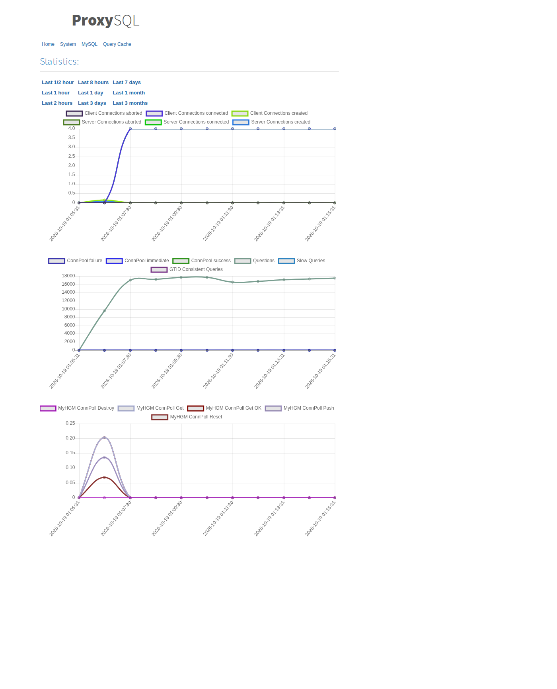

After `docker start mysql-3` the replication receiver was `ON` within a few seconds. ProxySQL left the server `SHUNNED` for longer than the configured 10 second recovery window. `LOAD MYSQL SERVERS TO RUNTIME` put it back to `ONLINE`. The application did not have to wait for that.

**What this means for your application.** If you have not sent any traffic to the replicas, losing one is invisible. You still want the alert: you have lost a copy of the data, and the next source failure has one less candidate. The application staying green is not the same as the cluster staying healthy.

## Experiment C: send some reads to the replicas, then lose the replicas

**What to expect.** A rule can move autocommit `SELECT`s onto hostgroup 20. It will not move the `SELECT`s inside `oltp_read_write`, because those run inside a transaction that already chose the writer. With one replica left, reads should continue after a short blip. With both replicas gone, those reads should fail and stay failed, while writes continue. Turning on `mysql-monitor_writer_is_also_reader` should be checked rather than trusted: on ProxySQL 2.7.3 it did not place the writer into the reader hostgroup. Putting the writer into hostgroup 20 by hand did, and reads came back in the same second.

**How to run it.** Add the rule on the ProxySQL admin port:

```sql
DELETE FROM mysql_query_rules;
INSERT INTO mysql_query_rules (rule_id, active, match_digest, destination_hostgroup, apply, comment)
VALUES (1, 1, '^SELECT', 20, 1, 'reads to reader hostgroup');
LOAD MYSQL QUERY RULES TO RUNTIME;
```

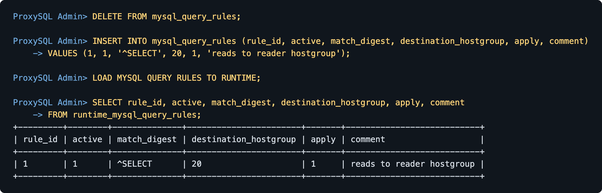

Leave the read/write sysbench running. Start a second client that sends only reads, outside a transaction, as text:

```bash
docker run --rm --network mysql-ha --entrypoint sysbench mysql-async-ha-sysbench:1 \
  /usr/share/sysbench/oltp_read_only.lua \
  --db-driver=mysql --mysql-host=proxysql --mysql-port=6033 \
  --mysql-user=sbuser --mysql-password=sbpass --mysql-db=sbtest \
  --tables=4 --table-size=10000 --threads=2 --time=0 \
  --report-interval=1 --mysql-ignore-errors=all \
  --db-ps-mode=disable --skip-trx=on \
  run
```

`--skip-trx=on` is the flag that lets the rule match. `--db-ps-mode=disable` keeps the statement text visible. The captured lines below start with a clock time because the lab prefixed one. A line from the command above starts at `[ 10s ]`. Compare from `thds` onward.

**What happened.** The read/write client kept succeeding (`err/s` 0, anywhere from about 640 to 1000 tps depending on how busy the box was). Its `SELECT`s never moved. The admin digest showed the split that did happen: hostgroup 10 had about 14.4 million calls (the read/write workload) and hostgroup 20 had 215 182 calls (the autocommit reads) before the replicas were killed. The rule-hit counter (`stats_mysql_query_rules`, columns `rule_id` and `hits`) climbed with the read client: 169 881 hits after a few seconds, 668 142 hits by the end of the fallback below.

The read client itself sat around 520–640 tps, reads only (`r/w/o` has zeros in the write and other columns), `err/s` 0.

**One replica down.** `docker kill mysql-3` at 01:17:02.

```text
01:17:02 [ 10s ] thds: 2 tps: 579.99 qps: 8121.88 err/s: 0.00 reconn/s: 0.00
01:17:03 [ 11s ] thds: 2 tps: 820.61 qps: 11490.60 err/s: 1.00 reconn/s: 0.00
01:17:04 [ 12s ] thds: 2 tps: 731.40 qps: 10249.63 err/s: 0.00 reconn/s: 0.00
```

One thread hit the dead replica (`err/s` 1.00). From the next second the reads ran on the remaining replica, mysql-2, around 730–820 tps, `err/s` 0. Writes on mysql-1 stayed at `err/s` 0. Runtime:


**Both replicas down.** `docker kill mysql-2` at 01:17:14. Hostgroup 20 had no `ONLINE` server. The writer had not been copied into that hostgroup.

```text
01:17:14 [ 22s ] thds: 2 tps: 912.90 qps: 12775.59 err/s: 0.00
01:17:15 [ 23s ] thds: 2 tps: 266.83 qps: 3741.59  err/s: 0.00
01:17:16 [ 24s ] thds: 2 tps: 0.00   qps: 0.00     err/s: 2.00
01:17:17 [ 25s ] thds: 2 tps: 0.00   qps: 0.00     err/s: 0.00
01:17:18 [ 26s ] thds: 2 tps: 0.00   qps: 0.00     err/s: 2.00
```

Reads stop. `err/s` alternates 2.00 and 0.00 because two threads each fail, wait out the connect timeout, and fail again. That continued for as long as hostgroup 20 had only shunned servers. The write client, still on hostgroup 10, did not notice:

```text
01:17:17 [ 680s ] thds: 4 tps: 1013.47 qps: 20281.40 err/s: 0.00 reconn/s: 0.00
01:17:22 [ 685s ] thds: 4 tps: 901.94  qps: 18028.73 err/s: 0.00 reconn/s: 0.00
```

**The setting that sounds like a fallback.** At 01:17:23 this was run:

```sql
UPDATE global_variables SET variable_value='true'
 WHERE variable_name='mysql-monitor_writer_is_also_reader';
LOAD MYSQL VARIABLES TO RUNTIME;
```

Four seconds later the runtime table was still:

```text
hostgroup_id  hostname  status
10            mysql-1   ONLINE
20            mysql-2   SHUNNED
20            mysql-3   SHUNNED
```

Reads stayed at 0 tps through 01:17:26. ProxySQL logged `read_only_action_v2() detected RO=0 on server mysql-1:3306 for the first time after commit(), but no need to reconfigure`.

On ProxySQL 2.7.3 that variable is consulted when a server *changes* to `read_only=0` and ProxySQL has to move it. A server that is already the writer is left where it is. The replication-hostgroup table has no column of its own for "writer is also a reader" (that column exists on the group-replication and Galera tables). Setting the variable, then waiting, did not put mysql-1 into hostgroup 20, and the reads did not come back.

**The change that did restore reads.** Insert the current writer into hostgroup 20 and load it:

```sql
INSERT INTO mysql_servers (hostgroup_id, hostname, port, max_connections, status, comment)
VALUES (20, 'mysql-2', 3306, 200, 'ONLINE', 'writer also reader');
LOAD MYSQL SERVERS TO RUNTIME;
SAVE MYSQL SERVERS TO DISK;
```

This measurement was taken after experiment A, so the writer was already mysql-2 and the only live replica was mysql-3. `docker kill mysql-3` at 01:23:33 dropped the read client to 0 tps. The insert ran at 01:23:40. The same second, reads resumed:

```text
01:23:33 [ 21s ] thds: 2 tps: 438.23 qps: 6156.28  err/s: 0.00
01:23:34 [ 22s ] thds: 2 tps: 0.00   qps: 0.00     err/s: 0.00
01:23:35 [ 23s ] thds: 2 tps: 0.00   qps: 0.00     err/s: 1.00
01:23:39 [ 27s ] thds: 2 tps: 0.00   qps: 0.00     err/s: 1.00
01:23:40 [ 28s ] thds: 2 tps: 635.37 qps: 8893.20  err/s: 0.00
01:23:41 [ 29s ] thds: 2 tps: 834.58 qps: 11686.17 err/s: 0.00
01:23:45 [ 33s ] thds: 2 tps: 888.99 qps: 12449.87 err/s: 0.00
```

The extra row stayed. Turning the global back to `false` did not remove it: once ProxySQL has already seen `read_only=0`, it does not revisit that copy. Writes stayed on hostgroup 10 around 700–750 tps, `err/s` 0, while the reads were served by the same server through hostgroup 20.

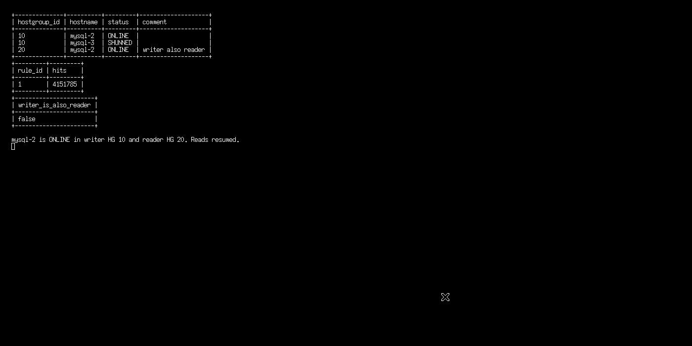

The failover hook does not do this insert. The default workload never reads from hostgroup 20, so the hook only has to publish a writer. If you add the `SELECT` rule, also put the current writer into hostgroup 20, or accept that losing every replica fails your reads while your writes continue.

**What this means for your application.**

- Routing reads to replicas takes load off the source. It also means a replica failure becomes visible to whatever sent those reads.
- One remaining replica is enough for this rule. ProxySQL uses whichever servers in the hostgroup are `ONLINE`.
- Zero `ONLINE` servers in the destination hostgroup is an error for that query. ProxySQL does not fall through to the user's default hostgroup.
- "Writer is also a reader" is a real idea, and on this ProxySQL version the global with that name did not implement it for a server that was already writable. The explicit `INSERT` did, in the same second, at the cost of sending read load back to the source.

## When something goes wrong

These are the failures hit while building and breaking this lab.

| What you see | What it usually is | What to do |
| --- | --- | --- |
| Replica stays `Connecting`. `SHOW REPLICA STATUS` has error 110 or `Can't connect to MySQL server`. Containers can ping the host, and cannot ping each other. | Docker 29 programmed nftables, and `iptables-legacy` still has FORWARD policy `DROP`. Packets between containers on the lab bridge are dropped. | `sudo iptables-legacy -S FORWARD`. If the first line is `-P FORWARD DROP`, run `sudo iptables-legacy -P FORWARD ACCEPT`. `deploy` does this only when that policy is `DROP`. A normal engine is left alone. |
| `ERROR 2002 ... Can't connect to local MySQL server through socket` just after mysql-1 starts. | `mysqladmin ping` succeeded against the image's temporary bootstrap server. That server then exits, and the real one is not up yet. | Wait until the log contains `MySQL init process done. Ready for start up.` and `SELECT 1` works. The manual and `deploy` already wait that way. |
| `ERROR 1064` on `CHANGE MASTER TO` or `SHOW SLAVE STATUS`. | Those statements were removed in MySQL 8.4. | Use `CHANGE REPLICATION SOURCE TO` and `SHOW REPLICA STATUS`. |
| Replicas apply, then Orchestrator refuses to promote, or the GTID sets differ on a fresh start. | Each container ran its own bootstrap, so each has its own GTID history. | Clone the source data directory and delete `auto.cnf` on the copies, which is what step 3 of the manual does. The three `gtid_executed` values must share one UUID before you start sysbench. |
| Orchestrator UI is up, `CountInstances` stays below 3. | Discovery has not walked from mysql-1 to the replicas yet, or the topology user cannot log in, or `report_host` is empty so the servers cannot see each other by name. | `curl -s http://127.0.0.1:13000/api/discover/mysql-1/3306` and wait. `/api/instances` returns 404 on this build; use `/api/clusters-info`. The replication-credentials query in the config must return five columns (user, password, and three empty TLS fields). |
| ProxySQL web page does not load, or the browser saves a file instead of showing it. | The page is HTTPS, digest auth, user `stats` / `stats`. Some browsers treat the page as a download because ProxySQL sends no `Content-Type`. | Open `https://127.0.0.1:16080/`, user `stats`, password `stats`. Hostgroup status is still the admin SQL, which is what the terminal screenshots show. |
| A server you just started is `SHUNNED`, and `LOAD` does not clear it immediately. | The monitor saw failed pings (often because `docker kill` removed the DNS name: `Unknown server host`). Recovery can take longer than `shun_recovery_time_sec` (10s here). | Confirm the container is running and replication is `ON`, then `LOAD MYSQL SERVERS TO RUNTIME` on the admin port. |
| Reads stay at 0 tps after you enabled `mysql-monitor_writer_is_also_reader`. | On 2.7.3 that variable does not copy an already-writable server into the reader hostgroup. | `INSERT` the current writer into hostgroup 20 and `LOAD MYSQL SERVERS TO RUNTIME`, as in experiment C. |
| `oltp_read_write` never shows traffic on hostgroup 20 after you added the `SELECT` rule. | Those statements run inside `BEGIN`, and the transaction stays on hostgroup 10. | Use a second client with `--skip-trx=on` and `--db-ps-mode=disable`. |
| `verify` fails after you have killed mysql-1. | `verify` checks the starting topology, with mysql-1 as the only online writer. | That failure is expected after experiment A. |

## What is different in production

The shape (source, two replicas, a proxy, an external failover manager) is what you would recognise in production. The settings are not.

- **Detection is fast on purpose.** Orchestrator polls every 2 seconds and gives up on a connect after 1 second. ProxySQL pings every second and shuns after two failures. A production Orchestrator poll is often 5–10 seconds, sometimes with several missed checks before a failover. The two-second stall in experiment A is this lab. Your users would wait longer.
- **Fencing a live old source is unfinished business.** If the source is partitioned and still accepts writes, you can get two writable servers (split brain). The hook tries to mark the old one `OFFLINE_HARD` in hostgroup 30 so ProxySQL will not use it. In the measured runs the hook's admin login was rejected, so the fence never ran; the shun plus the dead process were what kept writes away. The lab's hook now uses a login that works, but no run here has tested the fence against a partition. Do not treat this lab as proof that it holds.
- **The promoted replica forgets that it was promoted when it restarts.** Orchestrator clears `read_only` in memory. The config file still says `read_only=ON` and `super_read_only=ON`. A container restart of the new source comes back read-only, and writes fail until someone turns those variables off or another failover happens.
- **Async replication can lose committed transactions.** The client was told the commit succeeded before any replica had the change. Semi-sync replication makes the source wait until at least one replica has *received* the transaction before the client gets that answer. It costs latency on every commit, and it does not save you if the one replica that received it is the server that dies with the source. This lab is async so you can see the failure without that wait. The lost-transaction count was not measured.
- **The old source is not rebuilt for you.** After failover you have mysql-2 writable and mysql-3 copying from it. mysql-1 stays dead until you clone the new source and point mysql-1 at it. Orchestrator will not prefer mysql-1 if it comes back (`must_not`).
- **ProxySQL and Orchestrator are each a single container.** Losing either one is its own outage. Production runs more than one proxy, and often more than one Orchestrator process so the failover tool itself can die without taking the cluster with it.
- **Passwords, TLS, buffer pool, and durability settings** in these files are for a laptop. `sync_binlog=1` and `innodb_flush_log_at_trx_commit=1` are set so a commit is on disk on that server; they do nothing about the replication gap.

## Glossary

| Word | In this lab |
| --- | --- |
| Source | The MySQL server that accepts writes. mysql-1 at the start, mysql-2 after experiment A. Orchestrator calls it the master. |
| Replica | A MySQL server that copies the source. mysql-2 and mysql-3 at the start. |
| Asynchronous replication | The source commits, replies to the client, and replicas apply the change afterwards. |
| GTID | An id for each committed transaction, so a replica can ask for "everything I do not have yet". |
| Binary log | The file on the source that records those transactions. Replicas read it. |
| `read_only` / `super_read_only` | Settings that make a server reject writes. Replicas stay on. The new source is switched off in memory. |
| Hostgroup | A numbered list of servers inside ProxySQL. 10 is the writer, 20 is the readers. |
| Monitor | ProxySQL's login that checks `read_only` and pings. User `monitor`. |
| Query rule | A pattern that sends matching statements to a hostgroup. Experiment C sends `^SELECT` to hostgroup 20. |
| SHUNNED | ProxySQL tried to use a server, failed, and will skip it until it looks healthy. |
| `ONLINE` | ProxySQL will send queries to this server. |
| Failover / promotion | Orchestrator picks a replica, makes it writable, and points the other replica at it. |
| Hook | The shell script Orchestrator runs after a successful promotion. It edits ProxySQL. |
| Fence | An attempt to make the old source unable to take writes. Here, hostgroup 30 and `OFFLINE_HARD`. |
| Split brain | Two servers both accepting writes for the same data. |
| `tps` / `qps` / `err/s` / `reconn/s` | Transactions, queries, errors, and reconnects per second. See the worked example above. |
| sysbench | The program that pretends to be the application. |

## Clean up

From this directory:

```bash
./scripts/lab.sh teardown
```

That runs `docker compose -f docker/docker-compose.yml down -v --remove-orphans`. It deletes the lab containers, the data volumes (all MySQL data, ProxySQL's admin database, Orchestrator's sqlite file), and the `mysql-ha` network.

It does not change your host firewall back. If `deploy` printed that it set `iptables-legacy` FORWARD to `ACCEPT`, that change is still there.

A read-only sysbench you started by hand during experiment C is not part of Compose. Remove it with `docker rm -f` on that container name if it is still running.

`verify` is the check for a fresh deploy. It is the wrong check after experiment A.

## Files

```text
docker/docker-compose.yml          containers, ports, no restart policy
docker/mysql/mysql-1.cnf           source: read_only off, GTID on
docker/mysql/mysql-2.cnf           replica
docker/mysql/mysql-3.cnf           replica
docker/proxysql/proxysql.cnf       admin, web UI, monitor timings
docker/orchestrator/               image, config, failover hook
docker/sysbench/Dockerfile         sysbench 1.0.20
scripts/deploy.sh                  the one-command build
scripts/verify.sh                  the healthy-state check
scripts/teardown.sh                cleanup
scripts/lab.sh                     deploy | verify | teardown
docs/manual-setup.md               every command, with expected output
screenshots/                       the UI and terminal captures
```

MySQL 8.4 prints a warning that `binlog_format` is deprecated. The lab still sets it to `ROW`, which is already the default, so the replicas and Orchestrator agree on the format.
