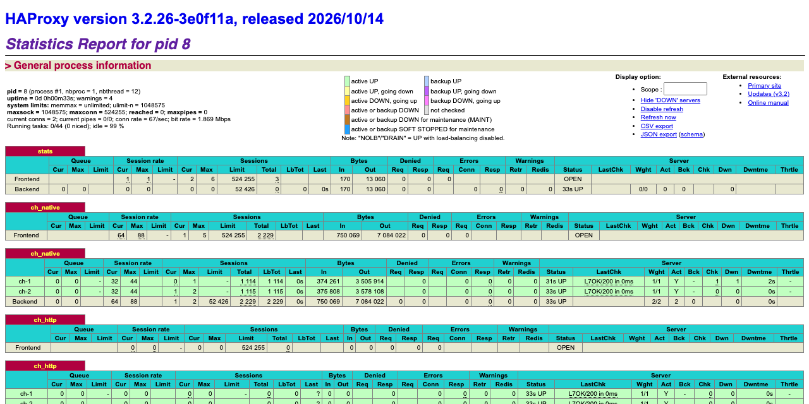
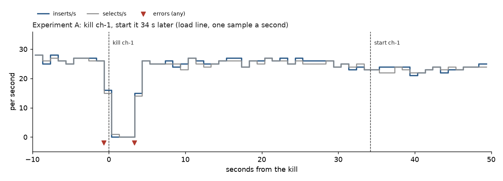
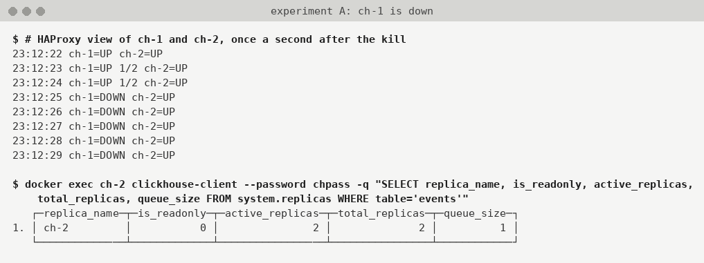
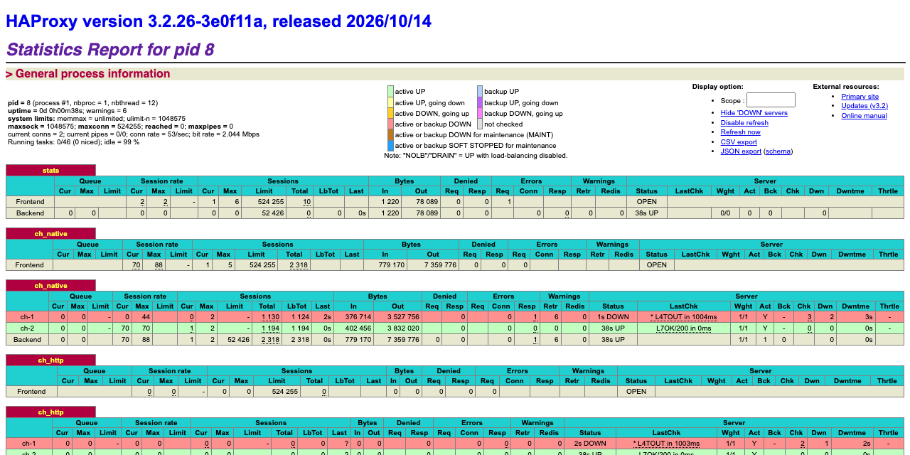
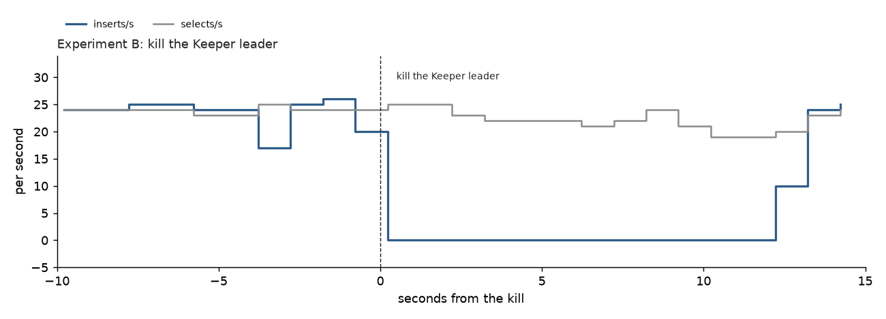
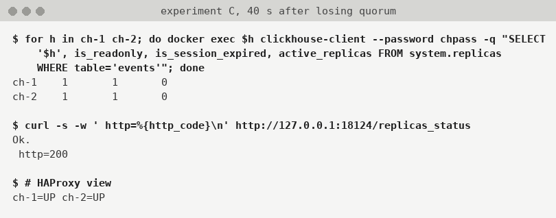
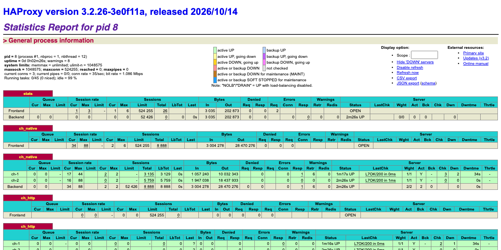

# ClickHouse – high availability for a replicated cluster

**Krzysztof Książek**

> Draft. Write-up: https://db-ex.eu/blog/clickhouse-replicated-ha/ (not published yet).

This is a hands-on lab for people who have used ClickHouse and have not yet watched a replica or a Keeper node die under load. Highly available, in this lab, means the application keeps a single address, and its inserts and selects either keep working or fail in a way it can see. You will build that on your laptop, break it on purpose, and see what the application experiences.

The numbers and command output are from real runs between 29 and 31 October 2026; unless a date is given, a time is on 29 October. Nothing here is mocked. Clock times are Madeira time (WET, UTC+0). The setup steps were run twice on a Debian 13 host with 8 cores, once as a first run and once as a clean rerun. The four experiments and the lost-data check are from one run on that host, between 21:00 and 21:11. The same commands were then run on a Mac (Apple Silicon, Docker Desktop) between 22:19 and 22:26; [On macOS](#on-macos) explains the memory errors it hit and the fix. The one-command `deploy` and `verify`, and the deduplicated retry at the end of experiment D, are from a third run on the Debian host at 22:38. Two more full runs on the Debian host, at 22:54 and 23:11, give the Debian ranges in [How repeatable are these numbers?](#how-repeatable), the figures, and the batch-by-batch no-loss check. Two full reruns on the Mac with the fix, on 30 October between 00:06 and 00:15 and on 31 October between 00:03 and 00:12, give the Mac column there; the HAProxy stats page screenshots are from the 31 October run. The tooling lives in [`20261029-clickhouse-replicated-ha`](https://github.com/ghkrzysztof-ksiazek/database-labs/tree/master/20261029-clickhouse-replicated-ha).

The [September lab](https://db-ex.eu/blog/clickhouse-a-replicated-cluster-on-your-laptop-with-kind-and-ansible/) builds a replicated ClickHouse cluster on Kubernetes. This one is smaller on purpose: plain Docker Compose, no Kubernetes, and the whole post is about breaking it. It is the ClickHouse counterpart of [MySQL – high availability for asynchronous replication](https://db-ex.eu/blog/mysql-async-replication-ha/), with the same shape: a proxy, the servers behind it, a coordinator, and a load generator that prints one line per second.

## What you will build

Two ClickHouse servers that hold the same table (the **replicas**), three ClickHouse Keeper nodes that coordinate them, and HAProxy in front so the application has a single address. There is no source and no failover tool. Either replica accepts inserts, and HAProxy simply stops sending traffic to one that has died.

```
your app (loadgen)
        |
        v
    HAProxy           the only address the app knows
        |
        +-- ch-1      replica, takes inserts and selects
        +-- ch-2      replica, takes inserts and selects

keeper-1, keeper-2, keeper-3
        a Raft ensemble that both replicas use
        to agree on which data parts exist.
When a replica dies, HAProxy routes around it.
When Keeper loses its majority, both replicas
stop accepting inserts.
```

You can build it in one command, or type every step yourself. Both paths end at the same containers.

```
./scripts/lab.sh deploy      # build everything and start the load generator
./scripts/lab.sh verify      # check the healthy starting state
./scripts/lab.sh teardown    # delete containers, volumes, and the network
```

`make deploy`, `make verify`, and `make teardown` do the same thing. Every command is also written out below in [Build it by hand](#build-it-by-hand), with the output it produced, and in [`docs/manual-setup.md`](https://github.com/ghkrzysztof-ksiazek/database-labs/blob/master/20261029-clickhouse-replicated-ha/docs/manual-setup.md).

## What you will learn

- How ReplicatedMergeTree replicates without a source: every replica writes parts, and the others fetch them.
- What ClickHouse Keeper does, why it needs two of three nodes, and what a replica does when it cannot reach a majority.
- Why a dead replica is still counted as active for up to 30 seconds.
- How HAProxy health-checks ClickHouse with `/replicas_status`, and the failure that check does not see.
- What `insert_quorum` and insert deduplication give you, and what they cost with two replicas.
- How to read a load line (`inserts/s`, `ins_err/s`, `selects/s`, `sel_err/s`), and what your application feels when a replica dies, when the Keeper leader dies, and when Keeper loses quorum.

## Before you start

|  |  |
| --- | --- |
| Operating system | Linux or macOS. The write-up was produced on Debian 13, and also run on macOS 27 on Apple Silicon. Ubuntu was not tried. |
| Docker Engine | 29.9.2 with Compose 5.6.1 on the Debian host. Docker Desktop on the Mac (Engine 29.7.2, Compose 5.4.0). Any current Docker Engine with the `docker compose` plugin should work. |
| Memory | Each ClickHouse server is capped at 4 GB (`max_server_memory_usage`). Under the lab load each used about 1.2 GB on the Debian host and about 2.4–2.5 GB on the Mac in the five-minute load test, with peaks of 2,658 to 2,813 MiB in the two full runs, so give Docker at least **6 GB**, or 8 GB on a Mac. [On macOS](#on-macos) explains why the Mac needs more. |
| Disk | About 1.8 GB for the three images (ClickHouse server, ClickHouse Keeper, HAProxy), plus a few hundred megabytes of data. |
| CPU | The Debian host had 8 cores, the Mac 12. Fewer cores were not tried. |
| Tools | `bash` and `curl`. `sudo` only if the Linux firewall check in step 1 needs it. |
| Time | The first run pulls the images. After that, `./scripts/lab.sh deploy` took 9.5 seconds on the Debian host. |

Ports on your machine. All of them are bound to `127.0.0.1`, and they sit above the MySQL lab's, so both labs can run together.

|  |  |  |
| --- | --- | --- |
| Application, native protocol (HAProxy) | `127.0.0.1:19000` | `app` / `app` |
| Application, HTTP (HAProxy) | `http://127.0.0.1:18123/` | `app` / `app` |
| HAProxy stats page | <http://127.0.0.1:18404/> | no login |
| ch-1 direct (HTTP, native) | `127.0.0.1:18124`, `:19001` | `default` / `chpass` |
| ch-2 direct (HTTP, native) | `127.0.0.1:18125`, `:19002` | `default` / `chpass` |
| keeper-1, keeper-2, keeper-3 | `127.0.0.1:19181`, `:19182`, `:19183` | no login |

`app` can only `SELECT` and `INSERT` on the `lab` database. It is the user the load generator connects as. `default` is the administrator; the commands in this post use it through `docker exec`, so you do not need a ClickHouse client on your machine.

This lab uses plain-text passwords and no TLS. That is deliberate, so you can read every command. Do not copy the files onto a real server. [What is different in production](#what-is-different-in-production) says what you would change.

## Ideas you need first

You can skip a subsection and come back when a later step uses the word.

### Every replica accepts inserts, and the others fetch what it wrote

A table with the **ReplicatedMergeTree** engine exists on each replica. An `INSERT` on ch-1 writes a new **part** (a small, immutable chunk of rows on disk) on ch-1 and records it in Keeper. ch-2 sees the record, downloads the part from ch-1 over HTTP, and has the same rows. The same happens in the other direction. Background **merges** combine small parts into larger ones, and they are coordinated the same way.

So there is no source and no replica in the MySQL sense. Nothing has to be promoted when a server dies, and there is no failover tool. The application can send an insert to either server. If one is gone, the other keeps taking inserts, and the returning server fetches the parts it missed. Replication is asynchronous by default: the client is told "inserted" once the part is on the server it talked to, before the other replica has fetched it.

### Keeper keeps the shared list, and it needs a majority

**ClickHouse Keeper** is a small coordination service that speaks the ZooKeeper protocol. Three Keeper nodes form a Raft ensemble: one **leader**, two **followers**. Every change to the shared list of parts goes through the leader and has to be written by a majority, two of the three, before it counts. If the leader dies, the other two elect a new one. If two die, the last node cannot form a majority, and it refuses to change anything.

A replica that cannot write to Keeper cannot register a new part, so it turns the replicated table **read-only**: selects still work, inserts fail with `TABLE_IS_READ_ONLY`. You will see that in experiment C, and you will see that "fail" can take a long time.

### Sessions expire after 30 seconds, and until then a dead server looks alive

Each replica holds a **session** with Keeper. If the replica dies, Keeper only notices when the session times out, after `session_timeout_ms` (30 seconds in this lab). Until then, `system.replicas.active_replicas` on the survivor still counts the dead server. Do not treat that column as live state.

### HAProxy checks `/replicas_status`, and what that check cannot see

Every ClickHouse server answers `GET /replicas_status` on its HTTP port with `Ok.` and HTTP 200 when its replicated tables are not too far behind. HAProxy calls it once a second and marks a server **DOWN** after two failures (`inter 1s fall 2`), and **UP** again after two successes (`rise 2`). A dead container fails the check, so HAProxy stops using it within about two seconds.

A server whose tables are read-only because Keeper has no majority is not behind. It still answers `Ok.` with HTTP 200, and HAProxy keeps both servers UP while every insert fails. Experiment C shows that.

### `insert_quorum` and deduplication

`insert_quorum = 2` on an insert makes the server wait until two replicas have the part before it tells the client "inserted". It is the nearest thing ClickHouse has to MySQL semi-sync. With two replicas it means both, so losing either one stops quorum inserts. If the server cannot tell whether the quorum was reached, it returns `UNKNOWN_STATUS_OF_INSERT`, and the rows may or may not be there.

The safe answer to that error is to send the same block again. Replicated tables remember a hash of each recently inserted block and drop an identical one (**insert deduplication**, on by default). Identical means the same rows: an insert that calls `now64()` produces a different block every time, so it would not be recognised as a retry.

### How to read a load line

The load generator is a short bash script that pretends to be the application. It runs one writer and one reader in parallel, both through HAProxy as the user `app`. The writer inserts 1,000 rows per statement, one statement after another. The reader runs a `GROUP BY` over the whole table, one after another. Every statement is a new `clickhouse-client` process with its own connection, so a dead server shows up as an error rather than as a stuck pool. Each time the writer gets "inserted" back, it writes the batch number to `out/acked.txt`, which is what the lost-data check uses at the end. Once a second it prints a line. A healthy line from the Debian host:

```
21:01:09 [ 9s ] inserts/s: 28 ins_err/s: 0 selects/s: 28 sel_err/s: 0
```

|  |  |
| --- | --- |
| Field | Meaning |
| `21:01:09` | Clock time of the second being counted, so you can line it up with a kill. |
| `[ 9s ]` | How long the load generator has been running. |
| `inserts/s` | Inserts that succeeded in that second. Each one is 1,000 rows. |
| `ins_err/s` | Inserts that returned an error in that second. |
| `selects/s` | Selects that succeeded in that second. |
| `sel_err/s` | Selects that returned an error in that second. |

The writer runs one statement at a time. So `inserts/s: 0 ins_err/s: 0` does not mean the writer is idle: it means one insert has been sent and has not come back, either way. That line, repeated, is what a hung insert looks like.

A healthy run on the Debian host sat around **23–28 inserts and 24–28 selects per second**, with no errors. The Mac ran about 40 of each. Compare a failure with the lines just before it, not with these numbers. About 25 small inserts per second is far more than you would want in production; [What is different in production](#what-is-different-in-production) comes back to that.

## Build it

From an empty directory:

```
git clone https://github.com/ghkrzysztof-ksiazek/database-labs.git
cd database-labs/20261029-clickhouse-replicated-ha
./scripts/lab.sh deploy
./scripts/lab.sh verify
```

`deploy` pulls the images, removes any earlier copy of the lab, starts the six containers, creates the table, loads a million rows, waits until HAProxy shows both servers UP, and starts the load generator. Its last lines on the Debian host, at 22:38:

```
== start the load generator ==
22:38:10 [ 1s ] inserts/s: 25 ins_err/s: 0 selects/s: 24 sel_err/s: 0
22:38:11 [ 2s ] inserts/s: 25 ins_err/s: 0 selects/s: 26 sel_err/s: 0
22:38:12 [ 3s ] inserts/s: 26 ins_err/s: 0 selects/s: 27 sel_err/s: 0
deploy: done. Run ./scripts/lab.sh verify
```

`verify` prints `verify: steady state ok` when Keeper has one leader and two followers, both replicas are writable and see each other, both hold the million seed rows, and HAProxy has both servers UP. It is safe to run while the load generator is writing. It was run five times in a row with the loader running, and passed each time. After the experiments it fails on purpose, because something is still down.

## Build it by hand

This is the same build, one command at a time, with the output from the Debian run. Run everything from one shell, in the order given: experiment B uses a shell function defined in step 8.

### 1. Check Docker

```
docker version --format '{{.Server.Version}}'
docker compose version --short
# Linux only (skip on macOS / Docker Desktop): containers on one bridge must reach each other.
# If the first line is "-P FORWARD DROP", open it for the lab:
sudo iptables-legacy -S FORWARD | head -1
sudo iptables-legacy -P FORWARD ACCEPT
```

On the Debian host, containers on the lab network resolved each other's names but could not connect until the legacy FORWARD policy was set to `ACCEPT`. It is the same trap the MySQL lab documents, and `deploy` makes the same change only when that policy is `DROP`. On macOS with Docker Desktop, skip both `iptables` lines: there is no `iptables-legacy`, and the lab networked fine without it.

### 2. Directory layout

```
mkdir -p clickhouse-ha/docker/{keeper,clickhouse/config.d,clickhouse/users.d,clickhouse/macros,haproxy} \
         clickhouse-ha/scripts clickhouse-ha/out
cd clickhouse-ha
```

That is the layout of the lab directory in the repository. If you cloned it, the files below already exist and you can read them instead of typing them.

### 3. Three Keeper configs

```
for i in 1 2 3; do cat > docker/keeper/keeper-$i.xml <<EOF
<clickhouse>
    <logger>
        <level>information</level>
        <console>true</console>
    </logger>
    <listen_host>0.0.0.0</listen_host>
    <keeper_server>
        <tcp_port>9181</tcp_port>
        <server_id>$i</server_id>
        <log_storage_path>/var/lib/clickhouse-keeper/coordination/log</log_storage_path>
        <snapshot_storage_path>/var/lib/clickhouse-keeper/coordination/snapshots</snapshot_storage_path>
        <coordination_settings>
            <operation_timeout_ms>10000</operation_timeout_ms>
            <session_timeout_ms>30000</session_timeout_ms>
            <raft_logs_level>warning</raft_logs_level>
        </coordination_settings>
        <four_letter_word_white_list>ruok,mntr,stat,srvr,conf,isro</four_letter_word_white_list>
        <raft_configuration>
            <server><id>1</id><hostname>keeper-1</hostname><port>9234</port></server>
            <server><id>2</id><hostname>keeper-2</hostname><port>9234</port></server>
            <server><id>3</id><hostname>keeper-3</hostname><port>9234</port></server>
        </raft_configuration>
    </keeper_server>
</clickhouse>
EOF
done
```

Each node gets its own `server_id` and the same list of three peers. Port 9181 is the client port the replicas use; 9234 is the Raft port the Keepers use among themselves. `mntr` and the other four-letter words are allowed so you can ask a node whether it is the leader.

### 4. ClickHouse server config

```
cat > docker/clickhouse/config.d/cluster.xml <<'EOF'
<clickhouse>
    <logger>
        <level>information</level>
        <console>true</console>
    </logger>
    <listen_host>0.0.0.0</listen_host>

    <!-- Lab-sized memory. "On macOS" in the post explains both settings. -->
    <merge_tree>
        <!-- drop merged-away parts after 10 s instead of 480 s -->
        <old_parts_lifetime>10</old_parts_lifetime>
        <cleanup_delay_period>1</cleanup_delay_period>
        <max_cleanup_delay_period>2</max_cleanup_delay_period>
    </merge_tree>
    <max_server_memory_usage>4000000000</max_server_memory_usage>
    <mark_cache_size>268435456</mark_cache_size>

    <!-- the Keeper ensemble every replica talks to -->
    <zookeeper>
        <node><host>keeper-1</host><port>9181</port></node>
        <node><host>keeper-2</host><port>9181</port></node>
        <node><host>keeper-3</host><port>9181</port></node>
        <session_timeout_ms>30000</session_timeout_ms>
        <operation_timeout_ms>10000</operation_timeout_ms>
    </zookeeper>

    <!-- one shard, two replicas -->
    <remote_servers replace="true">
        <lab>
            <shard>
                <internal_replication>true</internal_replication>
                <replica><host>ch-1</host><port>9000</port><user>default</user><password>chpass</password></replica>
                <replica><host>ch-2</host><port>9000</port><user>default</user><password>chpass</password></replica>
            </shard>
        </lab>
    </remote_servers>

    <distributed_ddl>
        <path>/clickhouse/task_queue/ddl</path>
    </distributed_ddl>
</clickhouse>
EOF
```

Both servers share this file: the three Keepers, a cluster called `lab` with one shard and two replicas, and two memory settings for a laptop. The load generator makes 25–35 inserts a second, each one a new part, and the `merge_tree` block removes the parts that merges have replaced after 10 seconds instead of the default 8 minutes, so they do not pile up in memory. The 4 GB cap is high enough for the Mac; the reason is in [On macOS](#on-macos). The per-server parts are the macros, which fill in `{shard}` and `{replica}` in the table definition, and the name the other replica should use to fetch parts:

```
for i in 1 2; do cat > docker/clickhouse/macros/ch-$i.xml <<EOF
<clickhouse>
    <macros>
        <cluster>lab</cluster>
        <shard>01</shard>
        <replica>ch-$i</replica>
    </macros>
    <interserver_http_host>ch-$i</interserver_http_host>
</clickhouse>
EOF
done
```

The application user:

```
cat > docker/clickhouse/users.d/app.xml <<'EOF'
<clickhouse>
    <users>
        <app>
            <password>app</password>
            <networks><ip>::/0</ip></networks>
            <profile>default</profile>
            <quota>default</quota>
            <grants>
                <query>GRANT SELECT, INSERT ON lab.*</query>
            </grants>
        </app>
    </users>
</clickhouse>
EOF
```

### 5. HAProxy

```
cat > docker/haproxy/haproxy.cfg <<'EOF'
global
    log stdout format raw local0 info

defaults
    log     global
    timeout connect 1s
    timeout client  60s
    timeout server  60s

# the HAProxy stats page
listen stats
    bind *:8404
    mode http
    stats enable
    stats uri /
    stats refresh 2s

# ClickHouse native protocol (clickhouse-client, most drivers)
frontend ch_native
    bind *:9000
    mode tcp
    option tcplog
    default_backend ch_native

backend ch_native
    mode tcp
    balance roundrobin
    option httpchk GET /replicas_status
    default-server check port 8123 inter 1s fall 2 rise 2 on-marked-down shutdown-sessions
    server ch-1 ch-1:9000
    server ch-2 ch-2:9000

# ClickHouse HTTP interface
frontend ch_http
    bind *:8123
    mode http
    option httplog
    default_backend ch_http

backend ch_http
    mode http
    balance roundrobin
    option httpchk GET /replicas_status
    default-server check inter 1s fall 2 rise 2 on-marked-down shutdown-sessions
    server ch-1 ch-1:8123
    server ch-2 ch-2:8123
EOF
```

The native protocol on port 9000 has no HTTP of its own, so `check port 8123` runs the HTTP check against each server's HTTP port. With `inter 1s` and `fall 2`, a dead server is marked DOWN after about two seconds. `on-marked-down shutdown-sessions` closes the connections that are still open to a server once it is marked DOWN, so a client waiting on a dead server gets an error instead of waiting for its own timeout.

### 6. Compose file

```
cat > docker/docker-compose.yml <<'EOF'
name: ch-ha

x-keeper: &keeper
  image: clickhouse/clickhouse-keeper:25.8
  networks: [ch-ha]

x-clickhouse: &clickhouse
  image: clickhouse/clickhouse-server:25.8
  networks: [ch-ha]
  environment:
    CLICKHOUSE_PASSWORD: chpass
    CLICKHOUSE_DEFAULT_ACCESS_MANAGEMENT: "1"
  ulimits:
    nofile: { soft: 262144, hard: 262144 }
  depends_on: [keeper-1, keeper-2, keeper-3]

services:
  keeper-1:
    <<: *keeper
    container_name: keeper-1
    hostname: keeper-1
    volumes:
      - ./keeper/keeper-1.xml:/etc/clickhouse-keeper/keeper_config.d/keeper.xml:ro
      - keeper-1:/var/lib/clickhouse-keeper
    ports: ["127.0.0.1:19181:9181"]
  keeper-2:
    <<: *keeper
    container_name: keeper-2
    hostname: keeper-2
    volumes:
      - ./keeper/keeper-2.xml:/etc/clickhouse-keeper/keeper_config.d/keeper.xml:ro
      - keeper-2:/var/lib/clickhouse-keeper
    ports: ["127.0.0.1:19182:9181"]
  keeper-3:
    <<: *keeper
    container_name: keeper-3
    hostname: keeper-3
    volumes:
      - ./keeper/keeper-3.xml:/etc/clickhouse-keeper/keeper_config.d/keeper.xml:ro
      - keeper-3:/var/lib/clickhouse-keeper
    ports: ["127.0.0.1:19183:9181"]

  ch-1:
    <<: *clickhouse
    container_name: ch-1
    hostname: ch-1
    volumes:
      - ./clickhouse/config.d/cluster.xml:/etc/clickhouse-server/config.d/cluster.xml:ro
      - ./clickhouse/macros/ch-1.xml:/etc/clickhouse-server/config.d/macros.xml:ro
      - ./clickhouse/users.d/app.xml:/etc/clickhouse-server/users.d/app.xml:ro
      - ch-1:/var/lib/clickhouse
    ports: ["127.0.0.1:18124:8123", "127.0.0.1:19001:9000"]
  ch-2:
    <<: *clickhouse
    container_name: ch-2
    hostname: ch-2
    volumes:
      - ./clickhouse/config.d/cluster.xml:/etc/clickhouse-server/config.d/cluster.xml:ro
      - ./clickhouse/macros/ch-2.xml:/etc/clickhouse-server/config.d/macros.xml:ro
      - ./clickhouse/users.d/app.xml:/etc/clickhouse-server/users.d/app.xml:ro
      - ch-2:/var/lib/clickhouse
    ports: ["127.0.0.1:18125:8123", "127.0.0.1:19002:9000"]

  haproxy:
    image: haproxy:3.2
    container_name: haproxy
    hostname: haproxy
    networks: [ch-ha]
    volumes:
      - ./haproxy/haproxy.cfg:/usr/local/etc/haproxy/haproxy.cfg:ro
    ports:
      - "127.0.0.1:18123:8123"
      - "127.0.0.1:19000:9000"
      - "127.0.0.1:18404:8404"
    depends_on: [ch-1, ch-2]

networks:
  ch-ha:
    name: ch-ha

volumes:
  keeper-1:
  keeper-2:
  keeper-3:
  ch-1:
  ch-2:
EOF
```

There is no restart policy, so a killed container stays down until you start it. Port 9181 on each Keeper is published only so you can look at it from your machine; the replicas talk to the Keepers over the lab network.

### 7. Start and wait

```
docker compose -f docker/docker-compose.yml up -d

# wait until both servers answer a query
until docker exec ch-1 clickhouse-client --password chpass -q "SELECT 1" >/dev/null 2>&1 \
   && docker exec ch-2 clickhouse-client --password chpass -q "SELECT 1" >/dev/null 2>&1; do
  sleep 1
done; echo ready
```

With the images already pulled, the clean rerun was ready in about 5 seconds.

### 8. Check the healthy state

Ask each Keeper for its role. The function stays defined in this shell, and the experiments use it again.

```
# Keeper roles: one leader, two followers
mntr() {
  for k in keeper-1 keeper-2 keeper-3; do
    s=$(docker exec $k bash -c 'exec 3<>/dev/tcp/127.0.0.1/9181; echo mntr >&3; cat <&3' 2>/dev/null \
        | awk '$1=="zk_server_state"{print $2}')
    echo -n "$k=${s:-down} "
  done; echo
}
mntr
```

```
keeper-1=leader keeper-2=follower keeper-3=follower
```

Then the server version, the cluster as ClickHouse sees it, which Keeper ch-1 is connected to, ch-1's own health check, and HAProxy's view:

```
docker exec ch-1 clickhouse-client --password chpass -q "SELECT version()"

docker exec ch-1 clickhouse-client --password chpass -q "
  SELECT cluster, shard_num, replica_num, host_name, port
  FROM system.clusters WHERE cluster = 'lab'
  FORMAT PrettyCompactMonoBlock"

docker exec ch-1 clickhouse-client --password chpass -q "
  SELECT host, port, is_expired FROM system.zookeeper_connection"

curl -s http://127.0.0.1:18124/replicas_status

sleep 3   # HAProxy needs two good checks (rise 2) before it shows UP
curl -s "http://127.0.0.1:18404/;csv" | awk -F, '$1=="ch_native" {print $2"="$18}'
```

```
25.8.33.6
   ┌─cluster─┬─shard_num─┬─replica_num─┬─host_name─┬─port─┐
1. │ lab     │         1 │           1 │ ch-1      │ 9000 │
2. │ lab     │         1 │           2 │ ch-2      │ 9000 │
   └─────────┴───────────┴─────────────┴───────────┴──────┘
keeper-3	9181	0
Ok.
FRONTEND=OPEN
ch-1=UP
ch-2=UP
BACKEND=UP
```

Look at the two rows of `system.clusters` (one shard, replicas 1 and 2), `is_expired` 0 on the Keeper connection, `Ok.` from `/replicas_status`, and both servers UP. On the Mac, without the `sleep 3`, HAProxy still showed both servers DOWN one second after the servers were ready: it needs two good checks before it marks a server UP.

### 9. Database and replicated table

```
cat > docker/clickhouse/schema.sql <<'EOF'
CREATE DATABASE IF NOT EXISTS lab ON CLUSTER lab;

CREATE TABLE IF NOT EXISTS lab.events ON CLUSTER lab
(
    ts      DateTime64(3),
    batch   UInt32,
    id      UInt64,
    user_id UInt32,
    value   Float64
)
ENGINE = ReplicatedMergeTree('/clickhouse/tables/{shard}/lab/events', '{replica}')
PARTITION BY toYYYYMMDD(ts)
ORDER BY (user_id, ts);
EOF

docker exec -i ch-1 clickhouse-client --password chpass --multiquery < docker/clickhouse/schema.sql
```

`ON CLUSTER` runs each statement on both servers. The output is one status row per server per statement: host, port, status 0 (success), an empty error, and how many servers were still to answer.

```
ch-1	9000	0		1	0
ch-2	9000	0		0	0
ch-1	9000	0		1	0
ch-2	9000	0		0	0
```

The Keeper path `/clickhouse/tables/{shard}/lab/events` is the same on both servers, because both have shard `01`. That shared path is what makes them replicas of one table. `{replica}` is different on each, so each registers itself under that path by its own name.

### 10. A million rows with known dimensions

```
docker exec ch-1 clickhouse-client --password chpass -q "
  INSERT INTO lab.events
  SELECT now64(3) - toIntervalSecond(number % 86400), 0, number,
         number % 10000, (number % 1000) / 10
  FROM numbers(1000000)"

for h in ch-1 ch-2; do
  echo -n "$h: "
  docker exec $h clickhouse-client --password chpass -q "
    SELECT count(), uniqExact(user_id), round(sum(value)) FROM lab.events"
done

docker exec ch-2 clickhouse-client --password chpass -q "
  SELECT replica_name, is_leader, is_readonly, absolute_delay,
         queue_size, active_replicas, total_replicas
  FROM system.replicas FORMAT Vertical"
```

```
ch-1: 1000000	10000	49950000
ch-2: 1000000	10000	49950000
Row 1:
──────
replica_name:    ch-2
is_leader:       1
is_readonly:     0
absolute_delay:  0
queue_size:      0
active_replicas: 2
total_replicas:  2
```

The million rows were inserted on ch-1 only, and ch-2 has the same count, the same number of distinct users, and the same sum. In `system.replicas`, look at `is_readonly` 0, `queue_size` 0 (nothing waiting to be fetched or merged), and `active_replicas` 2. `is_leader` is not a source: in current ClickHouse, more than one replica can be a leader at once, and it only means the replica may schedule merges.

Two selects through HAProxy's HTTP port, as `app`, land on different servers:

```
curl -s -u app:app http://127.0.0.1:18123/ --data-binary "SELECT hostName(), count() FROM lab.events"
curl -s -u app:app http://127.0.0.1:18123/ --data-binary "SELECT hostName(), count() FROM lab.events"
```

```
ch-1	1000000
ch-2	1000000
```

### 11. The load generator

```
cat > scripts/load.sh <<'EOF'
#!/usr/bin/env bash
# Pretend to be the application: one writer and one reader, both through HAProxy.
# Prints one line per second: inserts ok/err, selects ok/err.
# Every statement opens a new connection, so a dead backend shows up as an error.
set -u
HOST=${HOST:-haproxy}
OUT=${OUT:-/out}
mkdir -p "$OUT"
: > "$OUT/acked.txt"
CH="clickhouse-client --host $HOST --port 9000 --user app --password app --connect_timeout 1 --receive_timeout 10 --send_timeout 10"

writer() {
  local batch=0
  while true; do
    batch=$((batch + 1))
    if $CH -q "INSERT INTO lab.events SELECT now64(3), $batch, number, rand() % 10000, rand() / 1e6 FROM numbers(1000)" 2>>"$OUT/writer.err"; then
      echo "$batch" >> "$OUT/acked.txt"; echo "$(date +%s) ok"  >> /tmp/w.log
    else
      echo "$(date +%s) err" >> /tmp/w.log; sleep 0.2
    fi
  done
}

reader() {
  while true; do
    if $CH -q "SELECT user_id, count(), avg(value) FROM lab.events GROUP BY user_id ORDER BY count() DESC LIMIT 10 FORMAT Null" 2>>"$OUT/reader.err"; then
      echo "$(date +%s) ok" >> /tmp/r.log
    else
      echo "$(date +%s) err" >> /tmp/r.log; sleep 0.2
    fi
  done
}

: > /tmp/w.log; : > /tmp/r.log
writer & reader &
start=$(date +%s)
while true; do
  sleep 1
  prev=$(( $(date +%s) - 1 ))
  wo=$(grep -c "^$prev ok"  /tmp/w.log); we=$(grep -c "^$prev err" /tmp/w.log)
  ro=$(grep -c "^$prev ok"  /tmp/r.log); re=$(grep -c "^$prev err" /tmp/r.log)
  printf '%s [ %ss ] inserts/s: %s ins_err/s: %s selects/s: %s sel_err/s: %s\n' \
    "$(date -d @$prev +%H:%M:%S)" "$((prev - start))" "$wo" "$we" "$ro" "$re"
done
EOF
chmod +x scripts/load.sh

docker run -d --name loadgen --network ch-ha \
  -v "$PWD/scripts/load.sh:/load.sh:ro" -v "$PWD/out:/out" \
  --entrypoint bash clickhouse/clickhouse-server:25.8 /load.sh

docker logs -f loadgen    # Ctrl-C stops watching; loadgen keeps running
```

```
21:01:08 [ 8s ] inserts/s: 26 ins_err/s: 0 selects/s: 27 sel_err/s: 0
21:01:09 [ 9s ] inserts/s: 28 ins_err/s: 0 selects/s: 28 sel_err/s: 0
21:01:10 [ 10s ] inserts/s: 23 ins_err/s: 0 selects/s: 24 sel_err/s: 0
```

The load generator runs in its own container on the lab network, using the ClickHouse image for its client. It connects to `haproxy:9000`, the same address an application would use. `docker logs -f` never returns; press Ctrl-C to stop watching, and the load generator keeps running.

### 12. The healthy-state check

```
cat > scripts/verify.sh <<'EOF'
#!/usr/bin/env bash
# Healthy starting state: Keeper has a leader and two followers, both replicas are
# writable and see each other, both have the seed rows, HAProxy has both backends UP.
# Safe to run while loadgen is writing: it checks the seed (batch 0), which does not
# change, and allows a short replication queue instead of demanding an empty one.
set -euo pipefail
fail() { echo "verify: FAILED - $*"; exit 1; }
q() { docker exec "$1" clickhouse-client --password chpass -q "$2"; }

leaders=0; followers=0
for k in keeper-1 keeper-2 keeper-3; do
  state=$(docker exec "$k" bash -c 'exec 3<>/dev/tcp/127.0.0.1/9181; echo mntr >&3; cat <&3' \
          | awk '$1=="zk_server_state"{print $2}')
  [ "$state" = leader ] && leaders=$((leaders+1))
  [ "$state" = follower ] && followers=$((followers+1))
done
[ "$leaders" -eq 1 ] && [ "$followers" -eq 2 ] || fail "keeper: $leaders leader(s), $followers follower(s)"

for h in ch-1 ch-2; do
  row=$(q "$h" "SELECT is_readonly, active_replicas, absolute_delay < 10 FROM system.replicas WHERE database='lab' AND table='events'")
  [ "$row" = "$(printf '0\t2\t1')" ] || fail "$h replica state: $row (want is_readonly 0, active_replicas 2, delay under 10 s = 1)"
done

c1=$(q ch-1 "SELECT count() FROM lab.events WHERE batch = 0"); c2=$(q ch-2 "SELECT count() FROM lab.events WHERE batch = 0")
[ "$c1" = 1000000 ] && [ "$c2" = 1000000 ] || fail "seed rows: ch-1=$c1 ch-2=$c2 (want 1000000 each)"

up=$(curl -s "http://127.0.0.1:18404/;csv" | awk -F, '$1=="ch_native" && $2 ~ /^ch-/ && $18=="UP"' | wc -l)
[ "$up" -eq 2 ] || fail "haproxy: $up of 2 native backends UP"

echo "verify: steady state ok (keeper 1 leader + 2 followers, 2 writable replicas, $c1 seed rows each, haproxy 2/2 UP)"
EOF
chmod +x scripts/verify.sh
./scripts/verify.sh
```

```
verify: steady state ok (keeper 1 leader + 2 followers, 2 writable replicas, 1000000 seed rows each, haproxy 2/2 UP)
```

This version of `verify.sh` checks the seed rows (batch 0) rather than the full row count, and allows a short replication queue, so it can run while the load generator writes. An earlier version demanded an empty queue and identical totals; on the Mac it failed once with `ch-2 replica state: 0 2 1`, because one part was still waiting to be fetched. The version above was run on the Debian host with the loader running, not on the Mac.

## A healthy cluster

With the load generator running, open the HAProxy stats page at <http://127.0.0.1:18404/>. The `ch_native` and `ch_http` backends each list ch-1 and ch-2, both UP; in `ch_native` the sessions are spread over both. That page is the one to keep open during the experiments. The CSV form of it, which the commands below read, is `http://127.0.0.1:18404/;csv`.

The load lines are the sample in How to read a load line: 23–28 inserts and selects per second, no errors. On ch-2, `system.replicas` shows `active_replicas` 2 and a `queue_size` that goes up and down by a part or two as ch-2 fetches what the writer sent to ch-1.

[](screenshots/clickhouse-ha-healthy.png)

The healthy state, from a later run (23:12 WET): one Keeper leader and two followers, two replicas in cluster `lab`, and ch-2 writable with both replicas active.

[](screenshots/clickhouse-ha-haproxy-healthy.png)

The HAProxy stats page with the lab healthy, from the 31 October run on the Mac (00:04:17). Both servers in `ch_native` are UP.

## Experiment A: a replica dies

**What to expect.** About two seconds in which the statements on ch-1 do not come back, one error for each statement that was in flight there, then every statement goes to ch-2. HAProxy marks ch-1 DOWN. When ch-1 comes back, it fetches the parts it missed, and HAProxy puts it back into rotation.

**How to run it.** Leave the load generator running. In the same shell:

```
docker kill ch-1

# HAProxy's view, once a second
for i in $(seq 1 8); do
  echo "$(date +%T) $(curl -s "http://127.0.0.1:18404/;csv" \
    | awk -F, '$1=="ch_native" && $2 ~ /^ch-/ {printf "%s=%s ", $2, $18}')"
  sleep 1
done

docker exec ch-2 clickhouse-client --password chpass -q "
  SELECT replica_name, is_readonly, active_replicas, total_replicas, queue_size
  FROM system.replicas FORMAT PrettyCompactMonoBlock"
```

**What happened at 21:01:25.** ch-1 was killed at 21:01:25.9. HAProxy's view, once a second (`1/2` means one of the two failed checks it needs before DOWN):

```
21:01:26 ch-1=UP 1/2 ch-2=UP
21:01:27 ch-1=UP 1/2 ch-2=UP
21:01:28 ch-1=DOWN ch-2=UP
21:01:29 ch-1=DOWN ch-2=UP
```

The load generator, same clock:

```
21:01:24 [ 24s ] inserts/s: 26 ins_err/s: 0 selects/s: 25 sel_err/s: 0
21:01:25 [ 25s ] inserts/s: 26 ins_err/s: 0 selects/s: 24 sel_err/s: 1
21:01:26 [ 26s ] inserts/s: 0 ins_err/s: 0 selects/s: 1 sel_err/s: 0
21:01:27 [ 27s ] inserts/s: 0 ins_err/s: 1 selects/s: 0 sel_err/s: 1
21:01:28 [ 28s ] inserts/s: 20 ins_err/s: 0 selects/s: 20 sel_err/s: 0
21:01:29 [ 29s ] inserts/s: 26 ins_err/s: 0 selects/s: 27 sel_err/s: 0
```

Read it against the column guide. In the kill second (21:01:25), one select failed. In the next second, nothing finished: the writer had an insert on ch-1 and was waiting for it. At 21:01:27 that insert came back as an error, and one more select failed. At 21:01:28, the second HAProxy showed ch-1 DOWN, both clients were back at 20 statements per second, and from 21:01:29 at the rate from before the kill. That is 1 failed insert and 2 failed selects in total. The insert error in `out/writer.err`:

```
Code: 210. DB::NetException: Net Exception: Connection reset by peer (haproxy:9000, ...). (NETWORK_ERROR)
```

The connection was reset by HAProxy, not by ClickHouse. The client never saw an address change: it was talking to `haproxy:9000` before and after.

The same experiment in a later run, at 23:12:21, as a chart. The inserts stopped for 3 seconds, 2 inserts and 2 selects failed, HAProxy marked ch-1 DOWN 3.4 seconds after the kill, and there were no errors when ch-1 came back:

[](screenshots/clickhouse-ha-a-timeline.png)

Experiment A in the 23:12 run: inserts and selects per second from the load generator, errors as red markers, the kill and the restart of ch-1 as dashed lines.

[](screenshots/clickhouse-ha-a-ch1-down.png)

The HAProxy view and `system.replicas` on ch-2 after the kill in the same run. HAProxy has taken ch-1 out; Keeper still counts it as active.

[](screenshots/clickhouse-ha-haproxy-a-ch1-down.png)

The same stats page in experiment A of the 31 October Mac run, five seconds after ch-1 was killed (00:04:22): ch-1 DOWN after a layer 4 timeout, ch-2 UP.

About 8 seconds after the kill, ch-2 still counted two active replicas:

```
   ┌─replica_name─┬─is_readonly─┬─active_replicas─┬─total_replicas─┬─queue_size─┐
1. │ ch-2         │           0 │               2 │              2 │          0 │
   └──────────────┴─────────────┴─────────────────┴────────────────┴────────────┘
```

ch-1's Keeper session had not expired yet. That takes 30 seconds in this lab. Until then `active_replicas` says 2, and a monitoring check that relies on it would show a healthy cluster with one server dead.

**Bring ch-1 back.** At 21:02:02:

```
docker start ch-1
# wait until it answers again
until docker exec ch-1 clickhouse-client --password chpass -q "SELECT 1" >/dev/null 2>&1; do sleep 1; done

docker exec ch-1 clickhouse-client --password chpass -q "
  SYSTEM FLUSH LOGS;
  SELECT event_type, count(), min(event_time), max(event_time), sum(rows)
  FROM system.part_log
  WHERE table = 'events' AND event_time > now() - INTERVAL 60 SECOND
  GROUP BY event_type FORMAT PrettyCompactMonoBlock"
```

```
   ┌─event_type──────┬─count()─┬─────min(event_time)─┬─────max(event_time)─┬─sum(rows)─┐
1. │ NewPart         │      55 │ 2026-10-29 21:02:05 │ 2026-10-29 21:02:09 │     55000 │
2. │ MergeParts      │      70 │ 2026-10-29 21:02:04 │ 2026-10-29 21:02:09 │   7305000 │
3. │ DownloadPart    │      97 │ 2026-10-29 21:02:03 │ 2026-10-29 21:02:09 │   2527805 │
4. │ RemovePart      │       7 │ 2026-10-29 21:02:03 │ 2026-10-29 21:02:03 │   1539805 │
5. │ MergePartsStart │      70 │ 2026-10-29 21:02:04 │ 2026-10-29 21:02:09 │         0 │
   └─────────────────┴─────────┴─────────────────────┴─────────────────────┴───────────┘
```

ch-1 had missed 36 seconds of inserts. Between 21:02:03 and 21:02:09 it downloaded 97 parts from ch-2 (`DownloadPart`, 2,527,805 rows, many of them already merged on ch-2), wrote 55 new parts of its own from the inserts HAProxy sent it again (`NewPart`, 55,000 rows), and merged. HAProxy marked it UP at 21:02:05. The load generator recorded no errors on the way back. Nobody told ch-1 what it had missed: it compared its parts with the list in Keeper and fetched the difference.

On the Mac, the same `part_log` query, run one second after `docker start ch-1` without the wait loop, failed with `Connection refused`: the server was not accepting queries yet. That is why the loop is there.

**What this means for your application.** With this lab's timers, losing a replica costs about two seconds in which statements on that replica do not come back, then one error per statement that was in flight there, and then normal service on the other replica. The application's address does not change. Nothing has to be promoted, and the returning replica catches up on its own. What does not change quickly is the cluster's own view: for 30 seconds, `active_replicas` still counts the dead server.

## Experiment B: the Keeper leader dies

**What to expect.** The two remaining Keepers elect a new leader within a second or two. Inserts pause while the replicas reconnect to Keeper. Selects do not need Keeper and should not notice.

**How to run it.** ch-1 is back, and the load generator is still running. `mntr` is the function from step 8.

```
mntr
docker kill keeper-1        # it was the leader
for i in 1 2 3 4; do sleep 1; echo "$(date +%T) $(mntr)"; done
```

**What happened at 21:02:31.**

```
keeper-1=leader keeper-2=follower keeper-3=follower
21:02:32 keeper-1=down keeper-2=leader keeper-3=follower
21:02:33 keeper-1=down keeper-2=leader keeper-3=follower
```

```
21:02:30 [ 90s ] inserts/s: 25 ins_err/s: 0 selects/s: 24 sel_err/s: 0
21:02:31 [ 91s ] inserts/s: 8 ins_err/s: 0 selects/s: 21 sel_err/s: 0
21:02:32 [ 92s ] inserts/s: 0 ins_err/s: 0 selects/s: 19 sel_err/s: 0
21:02:33 [ 93s ] inserts/s: 0 ins_err/s: 0 selects/s: 22 sel_err/s: 0
21:02:34 [ 94s ] inserts/s: 13 ins_err/s: 0 selects/s: 22 sel_err/s: 0
21:02:35 [ 95s ] inserts/s: 24 ins_err/s: 0 selects/s: 23 sel_err/s: 0
```

keeper-2 was the leader within a second. Inserts dropped to 8 in the kill second and to 0 for the next two seconds, with no errors, and were back to the earlier rate at 21:02:35. Selects ran at 19–24 per second throughout.

**The stall was not always that short.** The same experiment was run five more times: on the Mac in the 22:19 run, twice more on the Debian host, at 22:56 and 23:13, and twice on the Mac with the fixed settings, on 30 October at 00:08 and on 31 October at 00:05. In four of them, a new leader was elected within about 2 seconds and inserts stopped for 11–12 seconds, again with no errors and no effect on selects. In the 30 October run, the new leader was there 1.1 seconds after the kill and inserts stopped for 1 second, also with no errors. The 23:13 run:

[](screenshots/clickhouse-ha-b-timeline.png)

Experiment B in the 23:13 run: the Keeper leader is killed at 0; inserts stop for 12 seconds with no errors, selects carry on.

Before that run, both replicas' Keeper sessions were on keeper-2, which survived (`SELECT host FROM system.zookeeper_connection` on each replica). A likely explanation, not confirmed: a follower passes writes on to the leader, and when the leader dies, requests already in flight wait for the 10 second `operation_timeout_ms` before the replica gives up on them and reconnects. Election (about 2 s) plus that timeout (10 s) is the 12 seconds seen. In the first run, where the stall was 2–3 seconds, the session placement was not recorded. If the sessions were on the killed leader, the connections would have been reset at once, which would explain the shorter stall. The 31 October Mac run fits it: both sessions were on keeper-1, which kept running when keeper-2 was killed (it missed one `mntr` check during the election), and inserts stopped for 12 seconds. The 30 October Mac run does not: its sessions were on keeper-2 and keeper-1, both of which survived the kill of keeper-3, and inserts still stopped for only 1 second. So the explanation stays unconfirmed.

**What this means for your application.** Losing the Keeper leader is a stall for inserts of 1–3 seconds at best and about 12 seconds in four runs of six, with no errors, and nothing for selects. Most applications would see it as a spike in insert latency. A client timeout shorter than about 15 seconds would turn it into errors. Keeper now has two of three nodes: it still has a majority, and it cannot lose another node. The next experiment takes that one.

## Experiment C: Keeper loses quorum

**What to expect.** With one Keeper of three left, there is no majority. Both replicas turn their replicated tables read-only. Selects keep working. Inserts fail. The surprise is how they fail: not quickly.

This is not the same failure as one replica losing its own connection to Keeper. Then only that replica goes read-only, the other keeps taking inserts, and a proxy can send writes to it. Here Keeper itself has lost its majority: every replica goes read-only at the same moment, there is no healthy replica to send inserts to, and, as you will see, the proxy does not notice.

**How to run it.** keeper-1 is still down from experiment B. Kill a second Keeper:

```
docker kill keeper-2        # keeper-1 is still down: 1 of 3 left

sleep 40   # longer than the 30 s Keeper session timeout
for h in ch-1 ch-2; do
  docker exec $h clickhouse-client --password chpass -q "
    SELECT '$h', is_readonly, is_session_expired, active_replicas
    FROM system.replicas WHERE table = 'events'"
done
curl -s -w ' http=%{http_code}\n' http://127.0.0.1:18124/replicas_status
curl -s "http://127.0.0.1:18404/;csv" | awk -F, '$1=="ch_native" {print $2"="$18}'
```

**What happened at 21:02:44.** Forty seconds after the kill, both replicas were read-only, their Keeper sessions were expired, and neither could see an active replica. ch-1's health check still said `Ok.`, and HAProxy still had both servers UP:

```
ch-1	1	1	0
ch-2	1	1	0
Ok. http=200
FRONTEND=OPEN
ch-1=UP
ch-2=UP
BACKEND=UP
```

The load generator, sampled:

```
21:02:44 [ 104s ] inserts/s: 26 ins_err/s: 0 selects/s: 25 sel_err/s: 0
21:02:45 [ 105s ] inserts/s: 0 ins_err/s: 0 selects/s: 24 sel_err/s: 0
21:02:57 [ 117s ] inserts/s: 0 ins_err/s: 0 selects/s: 22 sel_err/s: 0
21:03:27 [ 147s ] inserts/s: 0 ins_err/s: 0 selects/s: 23 sel_err/s: 0
21:05:07 [ 247s ] inserts/s: 0 ins_err/s: 1 selects/s: 21 sel_err/s: 0
21:07:30 [ 390s ] inserts/s: 0 ins_err/s: 1 selects/s: 19 sel_err/s: 0
```

From 21:02:45 the writer finished nothing. It sent an insert and waited. That insert came back as an error at 21:05:07, **143 seconds** after the kill. The next insert waited another 143 seconds and failed at 21:07:30. Selects ran at 19–26 per second, with no errors, the whole time. The error, once it arrived:

```
Code: 242. DB::Exception: Received from haproxy:9000. DB::Exception: Table is in readonly mode:
replica_path=/clickhouse/tables/01/lab/events/replicas/ch-2. (TABLE_IS_READ_ONLY)
```

This was the most repeatable number in the lab. In all three Mac runs and in two more runs on the Debian host, the first insert error came 142–143 seconds after the kill, and the next one 142–143 seconds after that. The 23:13 run:

[](screenshots/clickhouse-ha-c-timeline.png)

Experiment C in the 23:13 run: no insert finishes for almost five minutes, two insert errors 143 seconds apart, selects unaffected. Inserts resume about 10 seconds after keeper-2 is started.

[](screenshots/clickhouse-ha-c-readonly.png)

Forty seconds after the second Keeper died, in the same run: both tables read-only, the health check still `Ok.`, HAProxy still sending traffic to both.

[](screenshots/clickhouse-ha-haproxy-c-readonly.png)

The stats page in experiment C of the 31 October Mac run, 41 seconds after the second Keeper was killed (00:06:10). Both replicas were read-only at that point (`system.replicas`), and HAProxy still shows both UP.

**Why it waits.** An insert into a replicated table that cannot reach Keeper does not give up at once. It retries:

```
docker exec ch-1 clickhouse-client --password chpass -q "
  SELECT name, value FROM system.settings WHERE name LIKE 'insert_keeper%'"

time docker exec ch-1 clickhouse-client --password chpass -q "
  INSERT INTO lab.events SETTINGS insert_keeper_max_retries = 0
  SELECT now64(3), 0, 1, 1, 1"
```

```
insert_keeper_max_retries	20
insert_keeper_retry_initial_backoff_ms	100
insert_keeper_retry_max_backoff_ms	10000
...
Code: 242. ... Table is in readonly mode: replica_path=/clickhouse/tables/01/lab/events/replicas/ch-1. (TABLE_IS_READ_ONLY)
real	0m0.075s
```

`insert_keeper_max_retries` is 20, with a backoff that starts at 100 ms, doubles, and stops growing at 10 seconds. Seven waits of 0.1, 0.2, 0.4, 0.8, 1.6, 3.2 and 6.4 seconds add up to 12.7 seconds, and the remaining thirteen waits of 10 seconds add 130: about 143 seconds, which is what the writer saw. With `insert_keeper_max_retries = 0` on the insert, the same error came back in 0.075 seconds (the time includes `docker exec`), and in 0.053–0.096 seconds in the later runs.

**Restore quorum.** keeper-2 was started at 21:08:24:

```
docker start keeper-2
for i in $(seq 1 15); do
  sleep 1
  echo "$(date +%T) $(for h in ch-1 ch-2; do
    docker exec $h clickhouse-client --password chpass -q "
      SELECT '$h ro=' || toString(is_readonly) FROM system.replicas WHERE table = 'events'" | tr '\n' ' '
  done)"
done
```

```
21:08:33 ch-1 ro=1 ch-2 ro=1
21:08:35 ch-1 ro=1 ch-2 ro=1
21:08:36 ch-1 ro=0 ch-2 ro=0
--- loadgen ---
21:08:43 [ 463s ] inserts/s: 9 ins_err/s: 0 selects/s: 23 sel_err/s: 0
21:08:44 [ 464s ] inserts/s: 22 ins_err/s: 0 selects/s: 21 sel_err/s: 0
```

Both tables were writable again 12 seconds after keeper-2 started. In the later runs that took 4–10 seconds, and the two replicas did not always recover together: in the 23:13 run ch-1 was writable after 6 seconds and ch-2 after 10. The insert the writer was retrying at that moment then succeeded instead of failing, and by 21:08:44 inserts were back at the normal rate. So the long retry window works in both directions: it absorbs a short Keeper outage without a single error, and it turns a long one into inserts that hang for minutes.

**What this means for your application.**

- Losing Keeper's majority does not stop reads. It stops writes, on every replica at once, and the proxy cannot route around it, because there is nowhere better to go.
- With the default settings, the application does not get a fast error. Each insert blocks for about two and a half minutes and then fails with `TABLE_IS_READ_ONLY`. If your client has a timeout shorter than that, it gives up first and does not know what happened.
- HAProxy kept both servers UP, because `/replicas_status` kept answering `Ok.` with HTTP 200. The health check that handles a dead replica does not see this failure. Alert on `system.replicas.is_readonly` or on the Keepers themselves.
- Decide how long an insert should wait. `insert_keeper_max_retries` can be set per query, per user profile, or per server. Lower means you find out quickly and must retry yourself; the default means short Keeper hiccups never reach the application.

## Experiment D: `insert_quorum`, and what an unknown status means

**What to expect.** With both replicas healthy, a quorum insert takes as long as both need to have the part. With one replica just killed, the insert should wait for the quorum timeout and return an unknown status. Once Keeper has noticed that the replica is gone, quorum inserts should fail at once. The load generator does not use quorum, so it should barely notice.

**How to run it.** First bring keeper-1 back, so Keeper has all three nodes again. Then three quorum inserts, each 10 rows with its own batch number: healthy, one second after ch-2 is killed, and after its Keeper session has expired.

```
docker start keeper-1

# healthy: both replicas must confirm
time docker exec ch-1 clickhouse-client --password chpass -q "
  INSERT INTO lab.events SETTINGS insert_quorum = 2, insert_quorum_timeout = 5000
  SELECT now64(3), 900001, number, 1, 1 FROM numbers(10)"

docker kill ch-2; sleep 1
time docker exec ch-1 clickhouse-client --password chpass -q "
  INSERT INTO lab.events SETTINGS insert_quorum = 2, insert_quorum_timeout = 5000
  SELECT now64(3), 900002, number, 1, 1 FROM numbers(10)"

sleep 35     # longer than the 30 s Keeper session timeout
time docker exec ch-1 clickhouse-client --password chpass -q "
  INSERT INTO lab.events SETTINGS insert_quorum = 2, insert_quorum_timeout = 5000
  SELECT now64(3), 900003, number, 1, 1 FROM numbers(10)"

docker exec ch-1 clickhouse-client --password chpass -q "
  SELECT batch, count() FROM lab.events WHERE batch >= 900000 GROUP BY batch ORDER BY batch"
docker start ch-2
```

**What happened at 21:09:03.** ch-2 was killed at 21:09:03.

```
real	0m0.084s                       <- 900001, ok
Code: 319. ... Unknown quorum status. The data was inserted in the local replica
but we could not verify quorum. Reason: Timeout while waiting for quorum. (UNKNOWN_STATUS_OF_INSERT)
real	0m5.094s                       <- 900002
Code: 285. ... Number of alive replicas (1) is less than requested quorum (2/2).. (TOO_FEW_LIVE_REPLICAS)
real	0m0.081s                       <- 900003
900001	10
900002	10
```

The healthy quorum insert took 0.084 seconds. One second after the kill, Keeper still listed ch-2 as active, so ch-1 wrote the part and waited for ch-2 to confirm it. After the 5 second `insert_quorum_timeout` it returned `UNKNOWN_STATUS_OF_INSERT`, and batch 900002 is in the table: the rows were written on ch-1, and ch-2 fetched them after it came back. Once the session had expired, the third insert failed in 0.081 seconds with `TOO_FEW_LIVE_REPLICAS`, and batch 900003 is not in the table.

In two later runs the three timings were 0.099 and 0.107 seconds healthy, 5.096 and 5.100 seconds one second after the kill, and 0.147 and 0.084 seconds after the session had expired, with the same three outcomes.

The load generator, which does not use quorum, saw 2 insert errors and 2 select errors between 21:09:03 and 21:09:05, then carried on through ch-1, the same pattern as experiment A.

**Retrying after an unknown status.** In the third run, at 22:38, the same situation was repeated with a block that is byte-for-byte the same each time, because the timestamp is fixed instead of `now64(3)`. ch-2 was killed, the insert returned the unknown status, ch-2 was started again, and the identical insert was sent a second time:

```
Q="INSERT INTO lab.events SETTINGS insert_quorum = 2, insert_quorum_timeout = 5000
   SELECT toDateTime64('2026-10-29 22:40:00.000', 3), 900010, number, 1, 1 FROM numbers(10)"

docker kill ch-2; sleep 1
time docker exec ch-1 clickhouse-client --password chpass -q "$Q"

docker start ch-2
until docker exec ch-2 clickhouse-client --password chpass -q "SELECT 1" >/dev/null 2>&1; do sleep 1; done
sleep 5
time docker exec ch-1 clickhouse-client --password chpass -q "$Q"

for h in ch-1 ch-2; do
  echo -n "$h: "
  docker exec $h clickhouse-client --password chpass -q "
    SELECT batch, count() FROM lab.events WHERE batch = 900010 GROUP BY batch"
done
```

```
Code: 319. ... Unknown quorum status. The data was inserted in the local replica
but we could not verify quorum. Reason: Timeout while waiting for quorum. (UNKNOWN_STATUS_OF_INSERT)
real	0m5.153s
real	0m0.085s                       <- the retry, no error
ch-1: 900010	10
ch-2: 900010	10
```

The retry succeeded in 0.085 seconds, and there are 10 rows on each replica, not 20. Deduplication recognised the block. The same test ran in two more full runs on the Debian host, at 23:02 and 23:19: the first insert returned the unknown status after 5.096 and 5.099 seconds, the retry succeeded in 0.092 and 0.086 seconds, and each replica held 10 rows of batch 900010.

**What this means for your application.**

- `insert_quorum = 2` with two replicas means that losing either replica stops quorum inserts. With three replicas and a quorum of 2 you could lose one. That is the same arithmetic as Keeper's.
- `UNKNOWN_STATUS_OF_INSERT` does not mean the insert failed. In this run the rows were there. The client should send the identical block again and rely on deduplication. If the block is built with `now()` or a random value, it is not identical, and a retry can store the rows twice.
- For the first seconds after a replica dies, while its session is still alive, a quorum insert costs the full quorum timeout before it tells you anything.

## Did anything acknowledged go missing?

Stop the load generator, then compare the two replicas with each other, and compare what the writer was told with what is in the table:

```
docker stop loadgen

for h in ch-1 ch-2; do
  echo -n "$h: "
  docker exec $h clickhouse-client --password chpass -q "
    SELECT count(), uniqExact(batch), round(sum(value), 2) FROM lab.events"
done

# acknowledged loader batches vs batches in the table
wc -l < out/acked.txt
docker exec ch-2 clickhouse-client --password chpass -q "
  SELECT count(), uniqExact(batch), min(batch), max(batch)
  FROM lab.events WHERE batch BETWEEN 1 AND 899999"
```

```
ch-1: 5563020	4566	9849914567.75
ch-2: 5563020	4566	9849914567.75
4563
4563000	4563	1	4568
```

Both replicas have the same row count, the same number of distinct batches and the same sum. The writer got "inserted" for 4,563 of the 4,568 batches it sent, and the table holds 4,563 loader batches with 1,000 rows each, numbered 1 to 4,568. The 5 batches that returned errors (1 in experiment A, 2 in experiment C, 2 in experiment D) account for the gap. The total adds up: 1,000,000 seed rows, 4,563,000 loader rows, and 20 rows from the two quorum inserts that landed, 5,563,020.

Counts can hide two mistakes that cancel out, so the later runs compared the lists themselves: every batch number on each replica, and every batch number the writer was told had succeeded. `comm` needs its inputs sorted as text, not as numbers, hence `LC_ALL=C sort`:

```
docker stop loadgen
for h in ch-1 ch-2; do
  docker exec $h clickhouse-client --password chpass -q "
    SELECT DISTINCT batch FROM lab.events WHERE batch BETWEEN 1 AND 899999" \
    | LC_ALL=C sort > batches-$h.txt
  echo "$h: $(docker exec $h clickhouse-client --password chpass -q "
    SELECT count(), uniqExact(batch), sum(cityHash64(ts, batch, id, user_id, value))
    FROM lab.events")"
done
LC_ALL=C sort out/acked.txt > acked.txt
comm -23 batches-ch-1.txt batches-ch-2.txt | wc -l   # on ch-1 only
comm -13 batches-ch-1.txt batches-ch-2.txt | wc -l   # on ch-2 only
comm -23 acked.txt batches-ch-2.txt | wc -l          # acknowledged, missing
comm -13 acked.txt batches-ch-2.txt                  # stored, never acknowledged
```

[](screenshots/clickhouse-ha-no-loss.png)

The check at the end of the 23:12 run, which went through experiments A to D. The fingerprint is a sum of a hash of every column of every row, so two replicas with the same rows in different parts still match.

In both later runs on the Debian host, 4,344 and 4,490 batches were acknowledged, and both replicas held exactly those batches: none on one replica only, none acknowledged and missing, and none stored without an acknowledgement. The row fingerprints matched (5,344,030 and 5,490,030 rows). Each loader batch had exactly 1,000 rows, and each of the three quorum and dedup batches had 10. The six batches each run did not acknowledge are the six insert errors in that run's experiments, and none of them was stored. By the stricter check too, nothing the application was told had succeeded went missing, and nothing it was told had failed appeared anyway.

That is through two kills of a replica, the loss of the Keeper leader, and two and a half minutes of hung inserts. It is not proof against a server losing its disk, which this lab did not try.

## How repeatable are these numbers?

The whole sequence, from `deploy` through experiments A to D to the no-loss check and `teardown`, ran six times: three times on the Debian host (21:00, 22:54 and 23:11) and three times on the Mac, at 22:19 with the first memory settings and on 30 October at 00:06 and 31 October at 00:03 with the fixed ones. The later two Debian runs and the last two Mac runs used `tools/run-experiments.sh`, which runs the same commands as this post and keeps every output. The Mac column is the two runs with the fixed settings. The ranges:

|  |  |  |
| --- | --- | --- |
| What | Debian, 3 runs | Mac, fixed settings, 2 runs |
| A: seconds with no insert after the replica kill | 2–3 s | 0–3 s |
| A: failed inserts / selects | 1–2 / 2 | 1–2 / 1–2 |
| A: HAProxy marks ch-1 DOWN | 2–3.8 s | 2.5–3.9 s |
| B: new Keeper leader | under 1 s to 2.2 s | 1.1–2.1 s |
| B: insert stall, no errors | 2–3 s once, 11–12 s twice | 1 s once, 12 s once |
| C: first insert error after the kill, then the next | 142–143 s, then 142–143 s | 142–143 s, then 143 s |
| C: select errors while read-only | 0 | 0 |
| C: HAProxy while read-only | both UP, HTTP 200 | both UP, HTTP 200 |
| C: with `insert_keeper_max_retries = 0` | 0.075–0.096 s | 0.055–0.059 s |
| C: writable after quorum is back | 4–12 s | 1–10 s |
| D: quorum insert, healthy | 0.084–0.107 s | 0.080–0.098 s |
| D: one second after the ch-2 kill | 5.094–5.100 s, unknown status | 5.087–5.094 s, unknown status |
| D: after the session expired | 0.081–0.147 s, too few replicas | 0.064–0.066 s, too few replicas |
| D: retry of the identical block | 0.085–0.092 s, 10 rows on each replica | 0.071–0.072 s, 10 rows on each replica |
| Acknowledged batches missing | 0 (counts in the first run, batch lists in the other two) | 0 (7,134 and 6,416 batches, by batch list on both replicas) |

Experiment C and the quorum timings in D are fixed by settings, and they did not move. Experiment A moved by about a second on the Debian host, which is the one-second health check, and by more on the Mac (0–3 seconds with no insert). Experiment B is the one to treat with care; see the notes under it.

## On macOS

The same commands were run on a Mac between 22:19:52 and 22:26:39, as one script, with the lab removed at the end.

|  |  |
| --- | --- |
| Host | macOS 27.0.1, Apple Silicon (arm64), 12 cores, 24 GB |
| Docker | Docker Desktop, Engine 29.7.2, Compose 5.4.0, with a VM of 12 CPUs and 15.6 GiB |
| Images | ClickHouse and Keeper 25.8.33.6 (arm64), `haproxy:3.2` |

**The problem the Mac found.** From 22:20:48, about 35 seconds after the load generator started, about half of its selects failed with `MEMORY_LIMIT_EXCEEDED` (code 241), 1,246 in all. The final count on ch-1 failed the same way, so on the Mac the lost-data check covers ch-2 only: 6,904,020 rows, which is 1,000,000 seed rows, 5,904,000 loader rows and 20 quorum rows. The first version of this lab capped each server at 1.5 GB.

**What it was not.** The failing statement was the reader's `GROUP BY`, so the first guess was that the query used too much memory. It did not: in `system.query_log` it used 3–4 MiB (median) and at most 8 MiB. The error message says what was checked:

```
Code: 241. DB::Exception: Received from haproxy:9000. DB::Exception: (total) memory limit exceeded:
would use 459.08 MiB (attempt to allocate chunk of 0.00 B bytes), current RSS: 1.40 GiB, maximum: 1.40 GiB.
OvercommitTracker decision: Memory overcommit has not freed enough memory: While executing
AggregatingTransform. (MEMORY_LIMIT_EXCEEDED)
```

ClickHouse 25.8 refuses new allocations when the resident memory of the whole process (RSS) reaches `max_server_memory_usage`, not only when the memory it tracks for queries and merges does. The query wanted a few megabytes; the process was already at the cap, so whatever allocated next failed, and on this load that was nearly always the reader.

**What filled the memory.** Two things, measured with the scripts in `tools/` of the lab folder:

- **Old parts.** Every insert is a new part, 25–35 a second. When a merge replaces parts, the replaced ("outdated") parts stay for `old_parts_lifetime`, 480 seconds by default. On the Debian host there were up to about 5,200 of them per server, and resident memory reached 1,476 MiB, just over the cap, without an error by luck of timing. Removing them after 10 seconds kept the count under 600 and resident memory at about 1,150 MiB.
- **Memory the server does not count.** On the Mac, the allocator's figure (`jemalloc.allocated`) grew from about 0.7 GB to about 1.8 GB in the first four minutes and then levelled off, while the server's own tracked figure (`MemoryTracking`) stayed at about 100–500 MiB. The removal of old parts alone did not stop it. The server ran about 800 threads on the 12-CPU arm64 VM. Which allocations make up the difference was not pinned down; the server does not attribute them.

[](screenshots/clickhouse-ha-memory.png)

ch-2 resident memory under the lab load, five minutes from the start of the load. The dotted line is the old 1.5 GB cap. Mac lines from two 5-minute load tests at 22:55 and 23:23; Debian lines from the full runs at 22:54 and 23:11.

**The fix.** Both settings are in `cluster.xml` (step 4): old parts removed after 10 seconds, and a cap of 4 GB. In a five-minute load test on the Mac at 23:23 with these settings, resident memory levelled off at 2.4–2.5 GB, and 5,482 reader queries on ch-2 ran with no `MEMORY_LIMIT_EXCEEDED`. Both are lab settings. In production the cap comes from the size of the machine (`max_server_memory_usage_to_ram_ratio`), and inserts come in batches far larger than 1,000 rows, so there are far fewer parts.

**The full run with the fix.** The whole sequence, deploy through experiments A to D, the no-loss check and teardown, ran on the Mac with these settings on 30 October between 00:06:31 and 00:15:00. Neither the reader nor the writer got a `MEMORY_LIMIT_EXCEEDED`. Both replicas ended with 8,134,030 rows, and all 7,134 acknowledged loader batches were on both. Resident memory peaked at 2,813 MiB on ch-1 and 2,695 MiB on ch-2, under the 4 GB cap, with at most 781 and 831 outdated parts. A second full run on 31 October, between 00:03:39 and 00:12:16, was the same: no `MEMORY_LIMIT_EXCEEDED`, 7,416,030 rows and all 6,416 acknowledged batches on both replicas, peaks of 2,706 and 2,658 MiB, and at most 816 and 760 outdated parts. The two runs are the Mac column in [How repeatable are these numbers?](#how-repeatable).

The other changes the Mac needed are already in the commands above: skip the `iptables` lines in step 1, wait before the HAProxy check in step 8, wait for ch-1 to accept queries in experiment A, and run a real `sleep 40` in experiment C.

## When something goes wrong

These are the failures hit while building and breaking this lab.

|  |  |  |
| --- | --- | --- |
| What you see | What it usually is | What to do |
| Containers resolve each other's names, and cannot connect. Keeper never elects a leader, or the replicas cannot reach Keeper. | Docker programmed nftables, and `iptables-legacy` still has FORWARD policy `DROP`. Packets between containers on the lab bridge are dropped. | `sudo iptables-legacy -S FORWARD | head -1`. If it says `-P FORWARD DROP`, run `sudo iptables-legacy -P FORWARD ACCEPT`. `deploy` does this only when the policy is `DROP`. |
| Name lookups fail inside the containers. | `dockerd` was started with `--iptables=false`. Docker's embedded DNS needs its iptables rules. | Install iptables and restart `dockerd` without that flag. |
| HAProxy shows both servers DOWN just after start. | It needs two good checks (`rise 2`) before it marks a server UP. | Wait a few seconds. Step 8 has a `sleep 3`; `deploy` waits until both are UP. |
| `Connection refused` right after `docker start ch-1`. | The container is running, and the server is not accepting queries yet. | Wait until `SELECT 1` works, as experiment A does. |
| Inserts hang for minutes with no error, and selects work. | Keeper has no majority, and each insert is retrying (`insert_keeper_max_retries` 20, backoff up to 10 s). | Run `mntr` on each Keeper. Bring back enough nodes for a majority. To fail fast instead, set `insert_keeper_max_retries = 0` on the insert or the user profile. |
| Inserts fail with `TABLE_IS_READ_ONLY`, and HAProxy shows both servers UP. | `/replicas_status` answers `Ok.` while the tables are read-only for lack of Keeper. | Check `is_readonly` in `system.replicas` and alert on it separately from the proxy check. |
| `active_replicas` still counts a server you killed. | Its Keeper session has not expired yet (30 s here). | Wait out `session_timeout_ms`. Do not treat that column as live state. |
| `UNKNOWN_STATUS_OF_INSERT` on an insert with `insert_quorum`. | The quorum timed out. The rows may be on one replica. | Send the identical block again. Deduplication drops the copy, as in experiment D. |
| `TOO_FEW_LIVE_REPLICAS`. | Fewer live replicas than `insert_quorum` asks for. | Bring the replica back, or insert without quorum. |
| Selects fail with `MEMORY_LIMIT_EXCEEDED` (code 241), and the message says `current RSS` is at the maximum. | The server's resident memory reached `max_server_memory_usage`. With this lab's tiny inserts, outdated parts and untracked allocator memory fill it, more so on an Apple-silicon Mac. | Use the `cluster.xml` from step 4 (old parts removed after 10 s, cap 4 GB), and give Docker at least 6 GB (8 GB on a Mac). See [On macOS](#on-macos). |
| `verify` fails after an experiment. | `verify` checks the healthy starting state. After experiments B to D, a Keeper or a replica may still be down. | Start whatever is stopped, or tear the lab down and deploy again. |

## What is different in production

The shape (replicas that all accept writes, a three-node Keeper, a proxy in front) is what you would recognise in production. The settings are not.

- **Detection is fast on purpose.** HAProxy checks every second and gives up after two failures, and the Keeper session is 30 seconds. Production values are often longer, so the two-second stall in experiment A is this lab. Your users may wait longer.
- **Keepers belong on their own hosts.** Here all six containers share one machine, so a single host failure takes everything. In production, put the three Keepers on separate hosts, ideally separate zones, and not on the ClickHouse servers. Experiment C is what losing two of them looks like.
- **Small inserts are an anti-pattern.** 25 inserts of 1,000 rows per second makes a lot of parts and a lot of merges, which is why `part_log` is so busy in experiment A. Batch inserts on the client, or use `async_insert` and let the server batch them.
- **Two replicas and `insert_quorum = 2` is fragile.** Losing either replica stops quorum inserts. Three replicas with a quorum of 2 survive one loss.
- **Choose `insert_keeper_max_retries` on purpose.** The default hides short Keeper problems and turns long ones into inserts that hang for minutes. Whichever you pick, alert on read-only replicas, because the proxy check will not.
- **One HAProxy is a single point of failure.** Production runs more than one, behind a virtual IP or DNS, or lets the client library spread connections over the replicas itself.
- **Passwords, TLS, and memory** in these files are for a laptop. The 4 GB cap and the 10 second `old_parts_lifetime` exist because of this lab's tiny inserts; a real server takes its cap from its memory and keeps the default part lifetime.
- **This is one shard.** More data means more shards, each with its own replicas, and a `Distributed` table on top. The failures in this lab happen per shard.

## Glossary

|  |  |
| --- | --- |
| Word | In this lab |
| Replica | A ClickHouse server holding a copy of the table. ch-1 and ch-2. Both accept inserts. |
| ReplicatedMergeTree | The table engine that keeps the replicas in step through Keeper. |
| Part | An immutable chunk of rows on disk. Every insert makes at least one. |
| Merge | Background work that combines small parts into larger ones. |
| Fetch | A replica downloading a part from another replica. `DownloadPart` in `system.part_log`. |
| Keeper | ClickHouse Keeper, the coordination service. keeper-1, keeper-2, keeper-3. |
| Raft, leader, follower | How the three Keepers agree. One leader takes the changes; a majority must write each one. |
| Quorum (Keeper) | A majority of Keepers: two of three. Without it, replicated tables go read-only. |
| Session | A replica's connection to Keeper. It expires after `session_timeout_ms`, 30 seconds here. |
| `is_readonly` | A column in `system.replicas`: 1 means the table refuses inserts, usually because Keeper is unreachable. |
| `active_replicas` | How many replicas Keeper currently sees with a live session. It lags behind a kill. |
| `/replicas_status` | The HTTP endpoint HAProxy uses as its health check. |
| `insert_quorum` | How many replicas must have a part before the insert is acknowledged. |
| Deduplication | Replicated tables drop a block identical to one inserted recently, so a retry is safe. |
| `insert_keeper_max_retries` | How many times an insert retries its Keeper operations before failing. 20 by default. |
| `ON CLUSTER` | Run a DDL statement on every server in the named cluster. |
| Macros | Per-server values (`{shard}`, `{replica}`) substituted into the table definition. |
| `inserts/s` / `ins_err/s` / `selects/s` / `sel_err/s` | Successful and failed statements per second from the load generator. See the worked example above. |
| loadgen | The container that pretends to be the application. |

## Clean up

From the lab directory:

```
./scripts/lab.sh teardown
```

That removes the `loadgen` container (it is started with `docker run`, so Compose does not know about it), runs `docker compose -f docker/docker-compose.yml down -v --remove-orphans`, and deletes the loader's files in `out/`. It deletes the six lab containers, the five data volumes, and the `ch-ha` network. After `teardown` on the Debian host, and after the same three commands by hand on the Mac, no lab containers, volumes or network were left.

If you built the lab by hand, the same in three commands:

```
docker rm -f loadgen
docker compose -f docker/docker-compose.yml down -v --remove-orphans
rm -rf out
```

Neither path removes the images (about 1.8 GB); `docker image rm` them if you want the space back. Neither changes your host firewall back. If step 1 or `deploy` set `iptables-legacy` FORWARD to `ACCEPT`, that change is still there.

## Files

```
docker/docker-compose.yml               3 Keepers, 2 ClickHouse, HAProxy, no restart policy
docker/keeper/keeper-{1,2,3}.xml        Raft ids and peers
docker/clickhouse/config.d/cluster.xml  Keeper list, cluster 'lab', memory caps
docker/clickhouse/macros/ch-{1,2}.xml   shard / replica macros
docker/clickhouse/users.d/app.xml       the application user
docker/clickhouse/schema.sql            database + ReplicatedMergeTree table
docker/haproxy/haproxy.cfg              native + HTTP frontends, /replicas_status check
scripts/load.sh                         writer + reader, one line per second
scripts/deploy.sh                       the one-command build
scripts/verify.sh                       the healthy-state check
scripts/teardown.sh                     cleanup
scripts/lab.sh                          deploy | verify | teardown
docs/manual-setup.md                    every command, with expected output
tools/run-experiments.sh                the whole post end to end, every output kept in results/
tools/analyse.py                        timings and the no-loss result from a results/ folder
tools/memdiag.sh, memiso.sh             the memory measurements in "On macOS"
tools/shot-haproxy.sh                   optional HAProxy stats page screenshot (needs Chrome)
screenshots/                            the figures in this post
out/                                    acked.txt, writer.err, reader.err from the loader
```

ClickHouse calls its coordination settings `<zookeeper>` even when the service is ClickHouse Keeper. The name is historical; nothing in this lab runs ZooKeeper.
